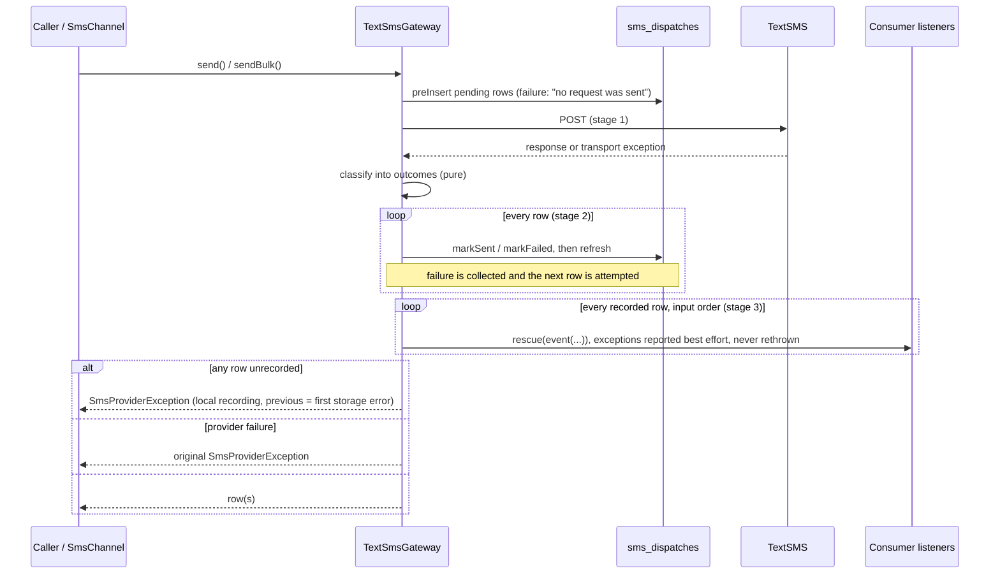

# T-01 — Lifecycle-event isolation

**Date:** 2026-11-01 (Africa/Nairobi)
**Baseline:** `main` @ `f6b76272d2d48e34b6e64956dfadcf7034d1f5ca`
**Directive:** `.docs/dev/directives/2026-11-01-first-wave-execution-directive.md` §5
**Decision applied:** D1-A — report listener exceptions and preserve the send result (owner, 2026-11-01)
**Review constraints:** AR-01, AR-04, AR-07; R37 description length moved forward from T-20
**Findings closed:** R01, R02, R03, R04, R37 (length cap; DB enforcement still a release gate)
**Status:** accepted after corrections and focused review on 2026-11-02;
not committed. The earlier review requested W1-01 to W1-04; correction
history remains in `T-01-review-corrections.md`. See the
[final acceptance](../reviews/codex/2026-11-02-t01-final-acceptance.md).
Sections below are updated where the corrections changed behaviour.

**2026-11-05 qualification:** isolation applies to exceptions raised during
immediate gateway dispatch. Host after-commit callbacks and queue workers
run outside that wrapper; see `docs/events.md`. No deferred execution
guarantee or automatic SMS retry is introduced.

## System intent

A consumer listener, or a local storage failure, must never change an
outcome TextSMS already decided, never trigger a second provider request,
and never hide that an SMS was sent. Before this change, consumer listeners
ran inside the provider-classification `try`/`catch`. Any listener
exception was relabelled as a provider failure, and the accepted row was
rewritten as `failed`.

## Mental model

`send()` and `sendBulk()` now run three separate stages:

1. **Provider I/O and classification.** Only the HTTP call, response
   parsing, and pure classification run here. Only this stage can produce a
   provider or transport failure. Classification yields one *outcome* per
   row (`accepted`, `rejected`, `transport_error`, `unexpected_error`), plus
   the provider exception to throw later, if any.
2. **Recording.** `finalize()` writes every row's outcome through
   `record()`: write, then re-read. A storage error, an observer that throws,
   or an observer that cancels the save is a *local recording failure* for
   that row. The remaining rows are still attempted. Nothing is compensated
   and nothing is re-sent.
3. **Publication.** One event per **recorded** row, in input order, through
   `publish()` → `rescue(fn () => event($e), fn ($err) => reportQuietly($err), report: false)`.
   `reportQuietly()` runs `report()` inside its own `rescue(..., report: false)`,
   so a failing exception handler is also contained (W1-02, 2026-11-02).

Then `finalize()` throws a local-recording `SmsProviderException` if any
row failed to record, otherwise the provider exception (rejection or
transport), otherwise returns the rows.

The DLR path (`recordDeliveryReport()`) keeps its existing persistence and
its D3-pending transition policy. Only its event now goes through
`publish()`.

## Critical invariants

| Invariant | Mechanism |
|---|---|
| A listener cannot rewrite provider outcome | Events fire after `finalize()` recording, outside every provider `try`/`catch`. |
| A listener cannot replace the return value or the provider exception | `publish()`: `rescue()` with `report: false` plus the separately contained `reportQuietly()` helper, so neither a listener nor a failing reporter escapes. |
| `SmsDispatchFailed` is attempted at most once per affected row | Only `finalize()` publishes; no catch block publishes. |
| A local failure is never presented as a provider rejection | No `markFailed()` after a recording failure; classification is complete before recording starts. |
| No event for an unrecorded result | `publish()` runs only for indexes in `$recorded`. |
| Exactly one provider request per `send()` / `sendBulk()` call (beyond existing HTTP-client retries, D2) | The recording failure path never re-enters stage 1. |
| Stored descriptions fit the column | `limitDescription()` = `mb_substr(…, 0, 255, 'UTF-8')` in `markSent()` and `markFailed()`. |

## Local persistence-error contract (as implemented)

| Situation | Persisted state | Events | Thrown | Recovery log |
|---|---|---|---|---|
| `preInsert` construction error (e.g. unencodable metadata), storage error, or cancelled insert | none (or the insert, if an observer threw after it) | none | `SmsProviderException`: "…could not be created; no request was sent to TextSMS", `previous` = cause | none (nothing was sent) |
| Unknown outcome (transport failure, unparseable or unmatched response), then the write fails | `pending` | none | "TextSMS gave no usable outcome for dispatch {ulid}: {detail}. … TextSMS may have accepted the SMS; resending it automatically is unsafe." | error, one entry, `provider_acceptance` = `unknown` |
| Accepted, then the write fails before SQL (`updating` throws) | `pending` | none | `SmsProviderException`: "TextSMS accepted dispatch {ulid} (provider message id {id}) … resending it automatically is unsafe", `providerCode` `200`, `previous` = cause | error, one entry |
| Accepted, observer throws after SQL (`updated`) | `sent` | none | same | same |
| Accepted, re-read fails (`retrieved` throws during `refresh()`) | `sent` | none | same | same |
| Accepted, observer cancels the update (returns `false`) | `pending` | none | same (`previous` = "cancelled the SmsDispatch update") | same |
| Rejected, then the write fails | `pending` | none | "TextSMS rejected dispatch (1004): …. Recording this outcome locally also failed …"; provider code, description, errors kept | same |
| Bulk, some rows fail to record | recorded rows: real outcome; others: whatever storage kept | recorded rows only, input order | "Recording the TextSMS bulk result locally failed for n of m dispatches; resending the batch as a whole is unsafe: TextSMS accepted a and may have accepted u of the m messages." (parts with zero counts omitted); accepted provider ids of unrecorded rows listed; `previous` = first failure | one entry listing every unrecorded row |
| Bulk rejected outright, some rows fail to record | as above | as above | "…TextSMS had rejected the whole batch: …" — no unsafe claim; provider code kept | same |

The recovery log entry is `TextSmsGateway: dispatch result could not be
recorded locally` (level `error`, best effort since W1-02: the exception is
built first, and a failing logger is swallowed). Its context contains
`unrecorded` (per row: `dispatch_id`, `dispatch_ulid`, `client_message_id`,
`provider_outcome`, `provider_acceptance`, `provider_code`,
`provider_message_id`), `total`, and the storage exception **class**. It never contains credentials, recipients,
message bodies, the full provider response, or the storage exception
message (a query exception message can embed bound values).

`SmsChannel` already catches `SmsProviderException`, so every recording
failure is logged by the channel and the notification continues. That
covers the accepted-but-unrecorded case, where failing a queued
notification would cause a queue retry and a duplicate SMS.

## Changes

| Path | Change |
|---|---|
| `src/Gateways/TextSmsGateway.php` | Three-stage `send()` / `sendBulk()`; new private `classifySend()`, `classifyBulk()`, `acceptedOutcome()`, `failedOutcome()`, `finalize()`, `record()`, `publish()`, `recoveryContext()`, `recordingFailure()`, `preparationFailure()`, `providerMessageId()`, `limitDescription()`; `markSent()` / `markFailed()` return the `update()` result; `preInsert()` wraps storage failure; DLR event through `publish()`; class docblock and `DispatchOutcome` PHPStan type. No public signature changed. |
| `src/Exceptions/SmsProviderException.php` | PHPDoc only: the broader local-record meaning. |
| `docs/events.md` | "Delivery guarantees and listener failures" section; catalogue wording. |
| `tests/Feature/LifecycleEventIsolationTest.php` | New: 14 tests, 20 cases with datasets. |

Not changed (out of scope by directive): HTTP retry policy (D2/T-04), DLR
transition policy (D3/T-03), bulk input/response correlation (T-02),
morph handling (T-13), test doubles (T-14), event serialization (T-09).

## Edge cases → regressions

| # | Directive requirement | Test (`LifecycleEventIsolationTest.php`) |
|---|---|---|
| 1 | Throwing accepted listener: row sent, ids survive, `failed_at` null, reported, one request | `keeps an accepted dispatch sent and returns it…` |
| 2 | Throwing failed listener: attempted once; code, description, errors, cause kept | `attempts SmsDispatchFailed once…`, `keeps the transport cause…` |
| 3 | Bulk accepted / mixed / global rejection / transport: all recorded before the first listener; later rows still published | `records every bulk outcome before the first listener runs…` (4 datasets; asserts statuses seen *inside* the first listener) |
| 4 | Throwing DLR listener over real HTTP: 200, report persisted | `answers 200 and keeps the persisted report…` |
| 5 | First of two ordered listeners throws: second does not run | `stops at the first throwing synchronous listener…` |
| 6 | Accepted then storage/observer failure: no reclassification, no second request, recovery signal, cause kept, channel absorbs it | `reports a local recording failure after acceptance…` (pre-write, post-write, re-read), `treats an update cancelled…`, `lets SmsChannel absorb…` |
| 7 | Long accepted and failed descriptions ≤ 255, multibyte-safe | `limits stored descriptions to 255 characters…` (1-, 2-, 4-byte mix) |
| 8 | Middle-row bulk recording failure: later rows recorded, only recorded rows published, first cause, all incomplete rows in context, one request | `keeps recording later bulk rows after a middle-row recording failure…` (rows B and D fail) |
| — | Pre-provider preparation failure | `reports a local preparation failure without contacting TextSMS` |
| — | Rejection whose recording fails | `keeps the provider rejection details when recording the rejection fails` |
| — | Batch rejected outright is not called unsafe to resend | `does not call a batch TextSMS rejected outright unsafe…` |

Persisted state is always read through `DB::table()`, independently of
model events and of the model the gateway returned. Every test disables
stray HTTP (`Http::preventStrayRequests()`) and uses synthetic credentials
and recipients. Reported exceptions are asserted with `Exceptions::fake()`.

## Verification evidence (2026-11-01)

1. **Reproduction first.** The 18 initial cases ran against the unchanged
   gateway and all failed for the defect, not the harness. Accepted
   listener → `TextSMS unexpected error: accepted listener boom`. Failure and
   bulk listeners → raw `RuntimeException` escaped. Storage failure after
   acceptance → relabelled `TextSMS unexpected error: storage unavailable`.
   Descriptions stored at 360 characters. DLR listener → HTTP 500.
   **Cancelled update → no exception at all: the old code treated a vetoed
   write as success and would have published `SmsDispatchAccepted` for a
   row it never recorded.**
2. **After the fix:** the lifecycle file passes (20 cases, 165 assertions).
   The pre-existing 17 gateway tests and 4 channel tests pass unchanged.
3. **Integrated gate:** see `2026-11-01-first-wave-integration.md`.

## Trade-offs and limitations

- **Best-effort events.** `rescue()` protects the caller, not the listener
  chain. The first throwing synchronous listener stops later listeners for
  that event, including later queue submissions (test 5; documented in
  `docs/events.md`). There is no outbox, and no durable publication is
  claimed.
- **Unrecorded rows stay as storage left them.** An accepted but unrecorded
  row may read `pending`. Operators must use the recovery log or exception
  message, not the row alone. A later DLR cannot match a `pending` row,
  because its `provider_message_id` was never stored. Reconciling such rows
  is left to T-02/T-10 planning.
- **Transport failures** are still classified as `failed` and are still
  subject to the existing HTTP-client retry (D2/T-04 pending). This packet
  makes no claim about their safety beyond what the messages state.
- **Bulk preparation is still not atomic** (R05). A storage failure on a
  later `preInsert` now raises a clear preparation failure, but earlier rows
  remain `pending`. T-02 owns atomic preflight.
- **Outer transactions (AR-07).** If the caller wraps `send()` in a DB
  transaction that rolls back, the row disappears after a billed send. Not
  addressed here; documentation belongs to T-19.
- **Column enforcement.** SQLite does not enforce `VARCHAR(255)`. MySQL
  strict mode and PostgreSQL verification remain a release gate (T-21).

## Reviewer focus

1. `finalize()`: a provider exception is always created in stage 1 and
   thrown only after recording and publication; a recording failure takes
   precedence. Confirm this is the intended precedence.
2. The recording-failure message wording, especially when it says or does
   not say "unsafe" (`$resendUnsafe` = any outcome other than `rejected`).
3. `providerCode` `200` on a thrown exception for an accepted-but-unrecorded
   send. The directive asks to retain the observed code; callers that treat
   any `providerCode` as a rejection code need to read the message.
4. The `catch (Throwable)` in `send()` stage 1 still classifies unexpected
   parse/HTTP-client errors as `failed`, as before. Its scope is now only
   I/O and pure classification.
