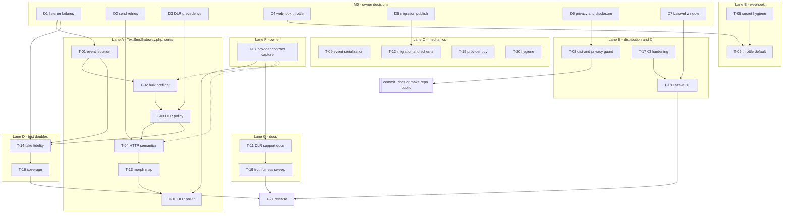

# Consolidated Analysis and Implementation Priorities

**Date:** 2026-11-01
**Author:** Claude (analysis pass — no production code was changed)
**Repository state:** `main` @ `f6b7627`; working tree clean except the untracked `.agents/`, `.claude/`, `.docs/`
**Inputs consolidated:**
`2026-06-09-package-readiness-review.md`, its remediation plan
(`Plan Address 2026-06-09 Package Readiness Review - ….md`),
`claude/2026-07-05-implementation-review-and-enhancement-plan.md`,
`packagist-publication-checklist.md`, every file under `src/`, `config/`,
`routes/`, `database/`, `tests/`, `.github/`, `docs/`, the provider PDF and
Postman collection, and the installed framework source in `vendor/`.

**Status of earlier documents:** they remain the record of their own findings.
For **execution**, use the task IDs in this document. §10 maps their IDs to
the IDs here.

**Audience:** engineers and coding agents who implement the backlog, and the
project owner, who must answer the decisions in §5.

---

## 0. How to use this document

**Current status (November 11):** the approved D2/D3/D4 behavior is preserved.
Remaining local release packets and actual verification evidence are in
[current pathway](../../implementation/2026-11-11-execution-status.md).
The findings/evidence sections below retain their original November 1 date.

| Section | Use it to |
|---|---|
| §1 | Read the verdict and the first actions. |
| §3 | Load the mental model and the five invariants every fix restores. |
| §4 | Look up any finding. One register; each entry cites a probe, a source line, or a provider document. |
| §5 | Answer (owner) or check (implementer) the decisions that block tasks. |
| §6 | Implement against the target behaviour. §6 overrides earlier plans. |
| §7 | Pick up a task. Each packet is self-contained. |
| §8 | See lanes, ordering, merge hotspots, and milestones. |
| §9 | Follow the working rules (condensed from `.agents/`). |

**Terms.**

- **Dispatch row:** one `sms_dispatches` record (`SmsDispatch` model). The package declares it the source of truth for delivery state.
- **Lifecycle events:** `SmsDispatchAccepted`, `SmsDispatchFailed`, `SmsDeliveryReported`.
- **DLR:** delivery report. **Push DLR:** TextSMS calls our webhook. **Pull DLR:** we call TextSMS `/api/services/getdlr/`.
- **Ambiguous send:** a send whose outcome at TextSMS is unknown because no response arrived (for example, a read timeout). The provider may have accepted and billed it.
- **Probe:** a temporary Pest case that asserts the *current* behaviour. A passing probe confirms a defect. Catalogue in Appendix A.

---

## 1. Executive summary

**Verdict.** The architecture is sound and the declared quality gates pass.
The package is **not ready** for a release candidate. Today's re-verification
confirms every state-integrity defect the earlier reviews found. It also
found defects and release risks that neither review recorded.

**New in this pass** (probe-confirmed unless marked):

1. A throwing `SmsDispatchAccepted` listener during `sendBulk()` leaves provider-accepted rows `pending` without a `provider_message_id`. Their DLRs can never match. **(P03, Critical)**
2. A throwing `SmsDispatchFailed` listener fires the event twice, erases the provider error code from the row, and escapes `send()` as a raw exception. `SmsChannel` does not catch it, so the whole notification fails. (P02)
3. Two bulk items with the same `clientReference` receive the same `provider_message_id`. The README recommends caller-chosen references. (P06)
4. Retrying on `ConnectionException` — the fix proposed on 2026-07-05 — still re-sends after a read timeout. That is the duplicate-SMS case. (P09 + Guzzle source)
5. The webhook stores the `?token=` shared secret in `dlr_payload` and in the `SmsDeliveryReported` payload on every DLR. (P10)
6. The shipped webhook default `throttle:60,1` rejects provider callbacks beyond 60 per minute per IP. The suite disables the throttle, so it was never exercised. (P11)
7. `notifiable_type` ignores the application's morph map. (P12)
8. `publishesMigrations()` does **not** prevent duplicate migrations on re-publish. Both plans and the publication checklist assume it does. (P13)
9. `FakeSmsGateway` stops intercepting once the `sms` channel is resolved, accepts invalid input, and its failure mode skips the failed-row and event path. The README claims the opposite. (P14, P19)
10. The ULID `clientsmsid` was introduced during extraction and has never been verified against the live provider. Bulk correlation depends on it. *(Unverified — source + provider docs.)*
11. Laravel 13.0.0 shipped on 2026-03-17. The package requires `illuminate/* ^12.0`, so no Laravel 13 application can install it. *(Packagist API.)*
12. A real test-recipient phone number is in tracked docs and git history. `.gitattributes` does not exclude `.docs/`, `.agents/`, or `.claude/` from the Composer archive. *(Source.)*

**Corrections to earlier plans** are in §4.2. The four with the largest
effect: the migration-publishing acceptance criterion, the retry predicate,
the DLR precedence rule, and the position of the live provider test (move it
to the start).

**Start now (P0):**

- Owner: answer D1–D7 (§5). Start T-07 (live provider contract capture) — it has the longest lead time.
- Engineering: T-08 first (minutes; it gates any commit of `.docs/`). Then T-01 → T-02 → T-03 → T-04 serially in `TextSmsGateway.php`, with T-05 → T-06 in parallel on the webhook.

---

## 2. Evidence baseline (2026-11-01)

**Environment:** Windows 11, PHP 8.2.12, Composer 2.7.6, laravel/framework
12.61.1, orchestra/testbench 10.11.0, pestphp/pest 3.8.6, phpunit 11.5.50,
phpstan 2.2.2, larastan 3.10.0, guzzlehttp/guzzle 7.11.1.

| Check | Command | Result |
|---|---|---|
| Test suite | `vendor/bin/pest --no-coverage` | 52 passed, 131 assertions. Test time 3.82 s (`--profile`); wall time ≈ 53 s (process start-up on this machine). |
| Static analysis | `vendor/bin/phpstan analyse` | Level 8, no errors |
| Code style | `vendor/bin/pint --test` | Passed |
| Manifest | `composer validate --strict` | Valid |
| Probes | temporary `tests/Feature/TempReviewProbeTest.php` | **21 passed, 59 assertions**, random seed 1793546919. File deleted after the run; working tree verified clean; no temp directories left. |
| Provider docs | `docs/text-sms-gateway-api-docs/*` | Read in full (PDF, 4 pages; Postman collection, 581 lines). No real credentials. |
| Framework currency | `repo.packagist.org/p2/laravel/framework.json` | Laravel 13.0.0 released 2026-03-17; latest 13.39.0 (2026-10-27) requires PHP `^8.3`. |

**Indirect evidence.** The four slowest tests are the four failure-shape
tests (≈ 0.24 s each). That matches the hard-coded 200 ms retry sleep on
4xx/5xx responses (R11).

**Not verified.** Any behaviour of the live TextSMS API. The repository
contains no record of a live call (the June review lists "Real provider DLR
smoke: Not proven"). T-07 closes this gap.

---

## 3. System mental model

Full architecture: [`docs/architecture.md`](../../../../docs/architecture.md).

- **Outbound.** `SmsChannel` → `SmsSender::send()` (bound to `TextSmsGateway`) → insert a `pending` row → POST to TextSMS → classify the response → mark `sent` or `failed` → fire a lifecycle event.
- **Bulk.** Same flow for ≤ 20 items in one POST. Rows are correlated to the response by `clientsmsid`.
- **Inbound.** `POST {prefix}/textsms/dlr` → `VerifyTextSmsCallback` (shared secret) → `TextSmsCallbackController` → `SmsDeliveryReportProcessor::recordDeliveryReport()` → update the row → fire `SmsDeliveryReported`.
- **Domain reconciliation** happens only in consumer listeners on the three events.

**Invariants the package claims.** §6 makes them enforceable.

| ID | Invariant | Violated today by |
|---|---|---|
| I1 | Provider I/O alone decides a row's provider outcome. Consumer code never changes it. | P01, P02 |
| I2 | Every row leaves `pending` once the provider call completes or input is rejected. | P03, P04 |
| I3 | A row never holds contradictory terminal state (`delivered_at` and `failed_at` both set). | P07 |
| I4 | One provider message maps to exactly one row. | P06, R08 |
| I5 | Secrets never persist in rows, events, logs, or command output. | P10, P16 |

---

## 4. Findings

### 4.1 Register

Severity: Critical / High / Medium / Low. *Origin:* June = 2026-06-09 review,
July = 2026-07-05 review, New = this pass. Line numbers refer to `f6b7627`.

**State integrity**

| ID | Sev | Finding | Evidence | Origin | Task |
|---|---|---|---|---|---|
| R01 | Critical | `SmsDispatchAccepted::dispatch()` runs inside the provider try (`TextSmsGateway.php:127`); a throwing listener lands in the catch-all (`:164`) and marks an accepted row `failed`. | P01 | June #1 | T-01 |
| R02 | Critical | `sendBulk()` fires `SmsDispatchAccepted` inside the per-row loop (`:259-279`) and has no catch-all. A throwing listener aborts the loop: later provider-accepted rows stay `pending` with no `provider_message_id`. | P03 | New | T-01 |
| R03 | High | A throwing `SmsDispatchFailed` listener (`:140-146`) re-enters the catch-all (`:164-171`): the event fires twice, `response_code` is overwritten with null, and the raw exception escapes. `SmsChannel.php:96` catches only package exceptions, so the notification fails. | P02 | New | T-01 |
| R04 | High | A throwing `SmsDeliveryReported` listener (`:335`) turns an already-persisted DLR into HTTP 500. | P18 | July | T-01 |
| R05 | High | Bulk preparation is non-atomic: an invalid later item leaves earlier rows `pending` (`:194-220`). | P04 | June #3 | T-02 |
| R06 | High | A malformed bulk item raises `ErrorException: Undefined array key "message"` instead of the contracted `SmsDispatchException` (`SmsSender.php:64`). | P05 | June #3 | T-02 |
| R07 | High | `parseBulkResponse()` keys responses by `clientsmsid` (`:611-613`). Duplicate `clientReference` values in one batch cross-wire `provider_message_id`. `README.md:82` recommends caller-chosen references. | P06 | New | T-02 |
| R08 | High *(unverified)* | The 26-character ULID `clientsmsid` (`:402-405`) was introduced at extraction (`docs/package-development-plan.md:278`). Provider docs show integer values only (PDF p.2–3; Postman line 118). If TextSMS does not echo it verbatim, every bulk row is marked `failed` with no code and no diagnostics (`:259-278`) while the SMS was sent. Single `send()` is unaffected. | Source + provider docs | New | T-07, T-02 |
| R09 | High | DLR reconciliation is not idempotent. A reversal keeps both terminal timestamps; a repeat moves the timestamp (`:320-328`). | P07 | June #4 | T-03 |
| R10 | Medium | DLR persistence is read-modify-write. Concurrent reports (webhook plus the future poller) race; the last writer wins. | Source | New | T-03 |

**Provider HTTP**

| ID | Sev | Finding | Evidence | Origin | Task |
|---|---|---|---|---|---|
| R11 | High | `->retry(2, 200, throw: false)` (`:372`) re-POSTs every non-2xx response, including permanent rejections. | P08 | June #5, July P6 | T-04 |
| R12 | High | `ConnectionException` covers read timeout (cURL 28) and empty reply (cURL 52) (`CurlFactory.php:518-523`; `PendingRequest.php:1808, 1831`). Retrying it re-sends ambiguous sends. The July fix keeps this risk on by default. | P09 | New (corrects July N1) | T-04, D2 |
| R13 | Medium | `balance()` returns provider error payloads, and `[]` for HTML failures, as balance data (`:345-360`). | P15 | June #11 | T-04 |
| R14 | Low | Empty credentials still cause a provider round-trip. | P20 | July N6 | T-04 |
| R15 | Info | Provider PDF p.4: `4090` = "Internal Error. Try again after 5 minutes" (the only documented transient code); `1008` = "No Delivery Report"; `1003` = "Invalid mobile number" (the gateway docblock says "validation"). | Provider PDF | New | T-04, T-10, T-20 |

**Webhook and security**

| ID | Sev | Finding | Evidence | Origin | Task |
|---|---|---|---|---|---|
| R16 | Critical (release) | TextSMS documents only pull DLR. Push method, schema, retry behaviour, and expected response are undocumented, yet the package presents push as canonical. The route accepts POST only. | Provider docs | June #2 | T-07, T-10, T-11 |
| R17 | High | The controller passes `$request->all()` (`TextSmsCallbackController.php:56`), which includes `?token=`. The secret is stored in `dlr_payload`, carried in the `SmsDeliveryReported` payload, and printed by `textsms:dispatch:show`. | P10 | New | T-05 |
| R18 | High | The shipped default `throttle:60,1` (`config/textsms.php:104`) keys on route domain + IP. All provider callbacks share one bucket; the 61st per minute gets 429. `tests/TestCase.php:62` overrides the middleware, so the suite never runs it. | P11 | New | T-06 |
| R19 | Medium | Denial logging writes the presented token via `fullUrl()` (`VerifyTextSmsCallback.php:87`). | P16 | June #8 | T-05 |
| R20 | Medium | The 422 path logs nothing, despite the docblock promise (`TextSmsCallbackController.php:21-22, 49`). | P17 | June #9 | T-05 |

**Package mechanics**

| ID | Sev | Finding | Evidence | Origin | Task |
|---|---|---|---|---|---|
| R21 | Medium *(re-scoped from High)* | Migration publishing uses a boot-time `date()` name (`TextSmsNotificationServiceProvider.php:178-180`). `publishesMigrations()` **also** duplicates on re-publish. The fix is convention alignment, not duplicate prevention. | P13 | June #6 (corrected) | T-12, D5 |
| R22 | Medium | Events lack `SerializesModels`. The trait works with the events' readonly promoted properties. | P21 (viability) | June #10 | T-09 |
| R23 | Medium | `notifiable_type = $notifiable::class` ignores the morph map (`TextSmsGateway.php:433`, `LogOnlySmsGateway.php:76`, `FakeSmsGateway.php:100`). `whereMorphedTo()` cannot find the rows. | P12 | New | T-13 |
| R24 | Low | UUID/ULID notifiable keys: `nullableMorphs()` follows `Schema::morphUsingUuids()`/`morphUsingUlids()` (`Blueprint.php:1559-1568`). It breaks only without that global setting or with mixed key types. The model types `notifiable_id` as `int` (`SmsDispatch.php:58`). | Source | July N4 (refined) | T-12, T-13 |
| R25 | Medium | `status` is a DB enum (migration `:42`) that includes `rejected`, which no code path sets (`SmsDispatch.php:39`). `attempt_count` defaults to 0 (`:50`) but every writer sets 1. | Source | July N3 | T-12 |
| R26 | Low | `registerChannel()` resolves `ChannelManager` eagerly in `boot()` (`:134`); dead `HttpKernel` block (`:156-161`). | Source | July N5 | T-15 |

**Test doubles**

| ID | Sev | Finding | Evidence | Origin | Task |
|---|---|---|---|---|---|
| R27 | Medium | `FakeSmsGateway::install()` silently no-ops without an app (`:64-76`); a swallow-all catch hides persistence failures (`:104-111`); `recordDeliveryReport()` always returns null (`:139-142`). | Source | June #12 | T-14 |
| R28 | Medium | `install()` has no effect once the `sms` channel was resolved, because `ChannelManager` caches drivers. | P14 | New | T-14 |
| R29 | Medium | The fake accepts an invalid phone and a blank body (violates the `SmsSender` contract). Its failure mode persists no row and fires no `SmsDispatchFailed`. `README.md:251-252` says it "fires the real events". | P19 | New | T-14, T-19 |
| R30 | Low | `LogOnlySmsGateway` leaves `client_message_id` null (`:66`); neither double enforces the 20-item bulk limit. | Source | July N7 | T-14 |

**Release, distribution, documentation**

| ID | Sev | Finding | Evidence | Origin | Task |
|---|---|---|---|---|---|
| R31 | High (adoption) | Laravel 13 cannot install the package (`composer.json`: `illuminate/* ^12.0`). | Packagist API | New (July N9: "verify") | T-18 |
| R32 | High (privacy, before going public) | A real test-recipient phone number is in tracked `docs/package-development-plan.md:530, 544`, in git history, and in two untracked `.docs/` plans. | Source | New | T-08, D6 |
| R33 | High (before committing `.docs/`) | `.gitattributes` has no `export-ignore` for `/.docs`, `/.agents`, `/.claude`, `/pint.json`, and lists a non-existent `.php-cs-fixer.dist.php`. Committed internal reviews would ship in every Composer install. | Source | New + June Low | T-08 |
| R34 | Medium | Docs claim more than the code does: `docs/roadmap.md:6` "v1.0 — shipped" (no tag exists); `docs/operations.md:59` "HTTP transport / 5xx — Safe to retry immediately" (unsafe, R12); its recipe re-sends the gateway-owned `provider_diagnostics` key (`:82`); `docs/webhooks.md:52` asserts unverified provider retry behaviour; `config/textsms.php:19` says "five credential keys"; CHANGELOG omits the ULID change. | Source | New + July N10 | T-19 |
| R35 | Medium | Coverage gaps (service provider, commands, `ChainedNormalizer`, LogOnly, alternate DLR keys `dlrstatus` / `messageID`). CI lacks prefer-lowest, `composer validate`, `composer audit`, PHP 8.4/8.5. | Source | June #13, July N8/N9 | T-16, T-17 |
| R36 | Low | Release toolchain: local Composer 2.7.6 is outdated. | Env | June | T-21 |
| R37 | Low *(static)* | `response_description` is `string(255)` (migration `:46`) but receives unbounded exception messages. MySQL strict mode and PostgreSQL reject over-length values; the write would fail inside a catch block and leave the row `pending`. SQLite does not enforce length. | Source | New | T-20, T-21 |
| R38 | Low | The code uses `Illuminate\Foundation\*` (only shipped in `laravel/framework`); T-09 adds `Illuminate\Queue`. Neither is declared in `require`. | Source | New | T-20 |
| R39 | Low | Public-method PHPDoc gaps; `phpstan.neon.dist` excludes a non-existent path and its ignore comment does not match the identifier. | Source | June Low | T-20 |

### 4.2 Corrections to the earlier plans

| # | Earlier claim | Evidence | Correction |
|---|---|---|---|
| C1 | `publishesMigrations()` makes re-publish repeat-safe (June #6 and its test; July 3.1; checklist §7). | P13: two publishes produced `2026_11_01_100001_…` and `2026_11_02_100001_…`. `VendorPublishCommand` checks for the original filename before it re-dates (`:257-261`, `:309-321`, `:348-370`). Laravel's default `update_date_on_publish` is `true`. | Adopt `publishesMigrations()` for framework convention and correct ordering. Acceptance = "the file is dated at publish time". Document "publish once". Remove every "repeat-safe" criterion. |
| C2 | Retry only on `ConnectionException` ⇒ "retry only when no response arrived", which is safe (July N1 / 1.4). | P09; `CurlFactory.php:518-523`. | "No response arrived" does not mean "not processed". Read timeouts and empty replies are ambiguous. See D2. |
| C3 | DLR policy "any → failed clears `delivered_at`" (June A.3; July 1.3). | Design review. | A stale `failed` report could overwrite `delivered` and make consumer listeners re-send. See D3. |
| C4 | The live provider test runs last (both plans; checklist §8). | R08, R16. | Its output gates poller parsing, bulk correlation, and the webhook contract. Move it to P0 as T-07. |
| C5 | `balance()` should throw whenever `response-code` is present (July 3.5). | The balance success shape is undocumented (Postman response body is `"{\n"`). | Throw on non-2xx, unparseable body, or a code other than `200`. Confirm the success shape in T-07. |
| C6 | Accepted-listener exceptions should propagate (July 1.1). | `SmsChannel.php:96` catches only package exceptions. | Propagation fails a queued notification after the provider accepted the SMS; the queue retry sends it again. *(Derived from code paths, not probed.)* See D1. |
| C7 | UUID/ULID notifiables break (July N4). | `Blueprint.php:1559-1568`. | They work when the app sets the global morph key type. Document it; do not redesign. |
| C8 | Checklist: `composer audit --locked`. | `.gitignore:11` ignores `composer.lock`. | Run `composer audit` after dependency install in CI (agrees with July N9). |
| C9 | June plan: new `RetryPolicy` contract + two classes + a manual loop. | `.agents/absolute_task_mode.md` (no structure without demonstrated need). | Use `PendingRequest::retry(when:)` (agrees with July N1). Keep the interface on the roadmap for failover, its first real consumer. |
| C10 | June plan: new `FakeSmsGateway::installWithoutPersistence()`. | No consumer requirement shown. | Remove the swallow-all catch. Add no new factory unless a consumer needs one. |

---

## 5. Owner decisions

Each decision blocks the listed tasks. The recommended option is first.

### D1 — What happens when a lifecycle-event listener throws? (blocks T-01, T-14)

- **A (recommended).** Fire events only after state is final, through `rescue(fn () => …, report: true)`. Listener exceptions go to the application's exception handler. They never change row state, the return value, or the thrown provider exception.
- **B (July plan).** Accepted-listener exceptions propagate; failed and DLR listener exceptions are reported.
- **Why A.** The SMS is irreversible and billed. Under B, a queued notification fails after acceptance and the queue retry sends a second SMS. A keeps the channel's documented promise: never fail the notification for SMS-side reasons. Durable consumer work belongs in queued listeners (T-09).
- **Cost of A.** A consumer can no longer use a sync-listener exception to abort its own flow.

### D2 — Which failures may `send()` / `sendBulk()` retry automatically? (blocks T-04)

- **A (recommended).** Retry only when the request provably never reached TextSMS: cURL errno 6 (DNS) or 7 (connection refused), read from `$e->getPrevious()?->getHandlerContext()['errno']`. Never retry a received response, a timeout, or an empty reply. `balance()` (no side effect) retries `ConnectionException` and 5xx.
- **B.** No automatic retry for sends. Simplest. A DNS blip fails the send; the row is `failed` and ops can retry.
- **C (July plan).** Retry any `ConnectionException`. Keeps the duplicate-SMS risk on by default.
- **Revisit** if T-07 shows that TextSMS deduplicates on `clientsmsid`.

### D3 — Which DLR wins when reports disagree? (blocks T-03, T-10)

- **A (recommended).** `delivered` is final. `failed → delivered` is allowed and clears `failed_at`. A later `failed` for a `delivered` row is logged and not applied; no event fires. A repeat of the same terminal state keeps the first timestamp, refreshes `dlr_payload`, and fires the event. An interim (`unknown`) report updates only rows still `sent`.
- **B (both plans).** The last report wins in both directions.
- **Why A.** Delivery to a handset cannot be undone, so a later "failed" is stale or a duplicate. Under B, a stale report can make consumer listeners re-send.

### D4 — Default rate limit on the DLR webhook (blocks T-06)

- **A (recommended).** Ship no throttle by default. Document how to add one sized above peak DLR volume. The shared secret is the access control, and DLR volume follows the consumer's own send volume.
- **B.** Keep a throttle with an env-configurable, higher default (for example `TEXTSMS_WEBHOOK_THROTTLE=600,1`). This only moves the cliff.

### D5 — Migration re-publish behaviour (blocks T-12)

- **A (recommended).** Use `publishesMigrations()` and document "publish once". These are the framework's own semantics (C1).
- **B.** Add a `Schema::hasTable()` guard in `up()`. Not recommended: rolling back the duplicate runs its `down()` and drops the live table.

### D6 — Privacy and disclosure before the repository goes public (blocks T-08, the visibility change, any commit of `.docs/`)

- (a) The test-recipient number in tracked docs and history: keep it (with consent), remove it from `HEAD` only, or rewrite history. A rewrite needs explicit authorization under `.agents/commit_directives.md`.
- (b) Commit `.docs/` and `.agents/` to the public repository, or keep them private. They contain unpatched security analysis until the P0 tasks land.

### D7 — Laravel support window (blocks T-18)

- **A (recommended).** `^12.0 || ^13.0`, widened only after a green matrix. Laravel 13 requires PHP `^8.3`; the Laravel 12 rows keep PHP 8.2.
- **B.** Laravel 13 only.

### Decision log

| Decision | Choice | Date | Decided by |
|---|---|---|---|
| D1 | A - Report listener exceptions and preserve the send result | 2026-11-01 | Owner - explicit selection in chat |
| D2 | One bounded retry for proven cURL 6/7 DNS/connect failures; other send failures retain existing handling | 2026-11-09 | Owner - explicit chat approval |
| D3 | Passive sanitized callback storage only; no submission-state/timestamp changes or application/event actions; supersedes A/B transition policies | 2026-11-09 | Owner - explicit chat approval |
| D4 | One configurable Laravel limiter, 600 authenticated callbacks/minute by default; existing env callback secret retained | 2026-11-09 | Owner - explicit chat approval |
| D5 | Native publish-once PHP migration; string16 status and attempt default1; existing tables need forward upgrades | 2026-11-11 | Engineering resolution under owner's resolve-all instruction |
| D6 | Owner approves `.docs/` and `.agents/`; local `.claude/` ignored; current redactions kept; owner accepts recipient remaining in history | 2026-11-11 | Owner / engineer |
| D7 | Laravel12/13 constraints and compatible test tools implemented; actual execution gates tracked separately | 2026-11-11 | Engineering resolution under owner's resolve-all instruction |

---

## 6. Target behaviour

**2026-11-09 scope amendment:** D2/D3/D4 now have explicit owner decisions
above. The passive D3 policy supersedes the historical state machine and
polling/domain-reconciliation requirements below; D4 keeps a bounded
configurable default. The actual minimal implementation scope and evidence
are in `../../implementation/2026-11-09-approved-minimal-resolutions.md`.
Historical recommendations below are retained as review history.

Specifications assume the recommended options. If the owner chooses
otherwise, update this section before implementation starts.

### 6.1 Lifecycle events

1. Persist first, then fire. No event fires inside a provider-classification `try`/`catch`.
2. `sendBulk()` persists every row's outcome before it fires any event.
3. The two outbound events use the isolated publication helper (D1-A),
   containing listener and reporter failures. Callback recording emits no events.
4. A provider failure always surfaces as `SmsProviderException`, whatever listeners do.
5. `SmsDeliveryReported` remains a compatibility class only. No new callback
   delivery event or application action is emitted; old queued work is host-owned.

### 6.2 Informational callback storage (approved D3)

Store the latest sanitized callback in the matched row's `dlr_payload`
only. Preserve submission state, identifiers, counters and all timestamps.
Suppress retrieval and write observers and emit no SDK events. Repeated or
reordered reports replace only that informational field; no outcome wins.
Unknown IDs are acknowledged; storage exceptions propagate. There is no
precedence engine, schema/history store, poller or application reconciliation
requirement. Existing outbound acceptance/unknown/refusal rules still apply.

### 6.3 Provider HTTP rules (approved bounded D2 slice)

`send()` and `sendBulk()` permit at most two Laravel-layer HTTP attempts,
200ms apart, only when structured cURL context proves DNS/connect error
6/7. Received HTTP responses, timeouts, empty replies and context-free
failures are not retried. Send redirects are disabled to prevent hidden
forwarding. Existing exception/diagnostic handling and balance behavior
remain unchanged. This does not promise an on-wire transmission cap or
provider idempotency.

The old T-04 credential guards and balance-response classification remain
separate pending work, not acceptance criteria for this minimal slice.
No retry-policy abstraction or extra retry configuration is introduced.

### 6.4 Bulk preflight rules

1. Validate every item before any write. Each item must be an array; `recipient` must be a string that normalises; `message` must be an `SmsMessage` with a non-empty trimmed body; `notifiable` must be null or a `Model`; resolved client ids must be unique within the batch.
2. On failure, throw `SmsDispatchException` that names the item index and the rule. Write zero rows. Make zero HTTP calls.
3. Insert all rows in one transaction on the model's connection, then POST.
4. A response row that cannot be matched to a client id → row `failed`, `metadata.provider_diagnostics.parse_source = 'unmatched'`, one warning log. Documentation: the outcome is unknown; do not retry automatically.

### 6.5 Webhook input rules

1. The processor receives `$request->except('token')`. The secret never reaches rows, events, logs, or command output.
2. Denial logs record the URL with the `token` value redacted, on both denial branches.
3. The 422 path writes one warning whose context lists payload **keys** only.
4. Default middleware per D4.

---

## 7. Backlog

### 7.1 Overview

**November 9 status:** this table is the original task inventory, not a
current open-task queue. T-03 is replaced by accepted passive recording;
T-04's bounded retry slice and T-06 are implemented/reviewed. T-04 credentials
and balance remain open. Current handoffs are in
[execution status](../../implementation/2026-11-09-execution-status.md).

Priority: **P0** start now (release-blocking or harm-preventing) · **P1**
before the RC tag · **P2** before stable `v1.0.0` · **P3** after 1.0.

| ID | Pri | Title | Lane | Depends on | Closes | Who |
|---|---|---|---|---|---|---|
| T-01 | P0 | Lifecycle-event isolation | A | D1 | R01–R04 | agent / engineer |
| T-02 | P0 | Atomic bulk preflight | A | T-01 (same file) | R05–R07, R08 (diagnostic) | agent / engineer |
| T-03 | P0 | Superseded by passive report recording (implemented/reviewed) | A | D3; T-02 (same file) | R09, R10 | agent / engineer |
| T-04 | P0 | Retry and credential/balance slices implemented/reviewed; see November11 evidence | A | D2; T-03 (same file) | R11–R14 | agent / engineer |
| T-05 | P0 | Webhook secret and input hygiene | B | — | R17, R19, R20 | agent / engineer |
| T-06 | P0 | Authenticated configurable 600/minute limiter (implemented/reviewed) | B | D4 | R18 | agent / engineer |
| T-07 | P0 | Provider contract capture (live) | F | — | R08, R16, C4, C5 | **owner only** |
| T-08 | P0 | Distribution and privacy guard | E | D6 | R32, R33 | engineer + owner |
| T-09 | P1 | Event serialization and listener contract | C | — | R22 | agent / engineer |
| T-10 | Deferred | Active DLR poller outside approved passive scope | A | T-03, T-07 | R16 | agent / engineer |
| T-11 | P1 | DLR support-level documentation | G | T-07 (final wording) | R16 | agent / engineer |
| T-12 | P1 | Migration and schema | C | D5 | R21, R24, R25 | agent / engineer |
| T-13 | P1 | Morph-map-correct notifiable persistence | A | T-04 (same file) | R23, R24 | agent / engineer |
| T-14 | P1 | Test-double fidelity | D | D1, T-01, T-03 | R27–R30 | agent / engineer |
| T-15 | P1 | Service-provider tidy | C | — | R26 | agent / engineer |
| T-16 | P2 | Coverage completion | D | T-01–T-15 | R35 | agent / engineer |
| T-17 | P2 | CI hardening | E | — | R35 | agent / engineer |
| T-18 | P2 | Laravel 13 support | E | D7, T-17 | R31 | agent / engineer (network) |
| T-19 | P2 | Documentation truthfulness sweep | G | behaviour tasks | R29, R34, C1, C8 | agent / engineer |
| T-20 | P2 | Code hygiene | C | — | R15, R37–R39 | agent / engineer |
| T-21 | P2 | Release execution | — | all | R36 | **owner** + engineer |

T-10's old conditional RC requirement is superseded by passive D3. No
poller/reconciliation implementation is required for informational storage.

### 7.2 Task packets

Every packet inherits the §9 rules. "Acceptance" lists permanent Pest cases;
most invert a probe from Appendix A.

#### T-01 — Lifecycle-event isolation · P0 · Critical

- **Objective.** Consumer listeners can never change provider-classified state (I1, I2).
- **Files.** `src/Gateways/TextSmsGateway.php` (`send` 94–173, `sendBulk` 178–293, `recordDeliveryReport` 295–343); `tests/Feature/TextSmsGatewayTest.php`; `tests/Feature/WebhookTest.php`.
- **Change.** (1) Narrow each `try`/`catch` to provider I/O, response parsing, and row persistence. (2) Add one private event helper per §6.1. (3) `sendBulk()`: persist all per-row outcomes, then fire events in input order. (4) Failure path: persist, fire `SmsDispatchFailed` once, throw `SmsProviderException`. (5) `recordDeliveryReport()`: fire through the helper after persistence.
- **Acceptance.**
  - `it('keeps an accepted dispatch sent when an SmsDispatchAccepted listener throws')` — row `sent`, `failed_at` null, row returned, `Exceptions::assertReported(RuntimeException::class)`.
  - `it('fires SmsDispatchFailed once and keeps the provider code when a failure listener throws')` — `SmsProviderException` with code `1004`; row `response_code = '1004'`; event count 1.
  - `it('persists every accepted bulk row before any listener runs')` — all rows `sent` with a `provider_message_id`.
  - `it('returns 200 and keeps the DLR update when an SmsDeliveryReported listener throws')`.
- **Out of scope.** Retry changes (T-04); DLR policy (T-03).

#### T-02 — Atomic bulk preflight · P0 · High

- **Objective.** Invalid input never creates rows; one provider message maps to one row (I2, I4).
- **Files.** `TextSmsGateway.php` (`sendBulk`, `parseBulkResponse`); tests.
- **Change.** §6.4.
- **Acceptance.**
  - Invalid later recipient → `SmsDispatchException` naming index 1; zero rows; `Http::assertNothingSent()`.
  - Missing `message` key, wrong `message` type, non-array item → `SmsDispatchException` naming the index.
  - Duplicate `clientReference` → `SmsDispatchException`; zero rows.
  - Response without a row's `clientsmsid` → that row `failed`, `parse_source = 'unmatched'`.
- **Notes.** T-07 step 2 tells us how often `unmatched` can occur in practice.

#### T-03 — Historical transition packet (superseded)

> Do not implement the transition requirements below. The approved replacement
> and actual verification are in [passive reports](../../implementation/T-03-passive-delivery-reports.md).

- **Objective.** Reconciliation is idempotent and never contradictory (I3).
- **Files.** `TextSmsGateway.php` (`recordDeliveryReport`; new private `applyDeliveryReport(...)` shared with T-10); tests.
- **Change.** §6.2, including the conditional-update persistence rule.
- **Acceptance.**
  - `failed → delivered` clears `failed_at`.
  - A repeat `delivered` keeps the first `delivered_at` (use `$this->travelTo()`).
  - `delivered` + `failed` report → row stays `delivered`, no event, one info log.
  - `sent` + `unknown` stores the payload only; `delivered` + `unknown` is ignored.
  - Alternate keys `dlrstatus` and `messageID` are covered (R35).

#### T-04 — Provider HTTP semantics · P0 · High

> The minimal retry slice is implemented/reviewed; see [bounded retry](../../implementation/T-04-bounded-send-retry.md).
> Original credential and balance work below remains pending. Historical
> retry configuration/abstraction proposals are outside the approved slice.

- **Objective.** The package never re-sends a possibly accepted message; balance errors are reported accurately; missing credentials fail fast.
- **Files.** `TextSmsGateway.php` (`http`, constructor, `balance`); `src/TextSmsNotificationServiceProvider.php` (`makeConfiguredSender` passes retry config); `config/textsms.php` (`providers.textsms.retry`); tests.
- **Change.** §6.3.
- **Acceptance.**
  - HTTP 422 → exactly 1 request. Provider code `1004` at HTTP 200 → 1 request.
  - `Http::failedConnection('cURL error 28: …')` → 1 request.
  - cURL errno 6 → `retry.times` requests. *Test note:* `Http::failedConnection()` builds a `ConnectException` without handler context. For errno-based cases, fake with `fn ($request) => Create::rejectionFor(new ConnectException('cURL error 6: …', $request->toPsrRequest(), null, ['errno' => 6]))`.
  - `balance()`: code `1006` at HTTP 200 → `SmsProviderException`; HTML 503 → `SmsProviderException`; a 5xx is retried.
  - Empty `api_key` → `SmsProviderException`, zero requests, zero rows.
- **Notes.** Add a CHANGELOG `BC` entry for the retry semantics. T-19 updates `docs/operations.md`.

#### T-05 — Webhook secret and input hygiene · P0 · High

- **Files.** `src/Http/Controllers/TextSmsCallbackController.php`; `src/Http/Middleware/VerifyTextSmsCallback.php`; `tests/Feature/WebhookTest.php`.
- **Change.** §6.5 items 1–3.
- **Acceptance.**
  - Valid DLR with `?token=` → `dlr_payload` has no `token` key; the event payload has no `token` key.
  - Denial with `?token=stale-secret` → no log context contains `stale-secret`. Same on the unconfigured-secret branch.
  - 422 → exactly one warning; its context holds payload keys only.
- **Ops note (owner).** After this ships, rotate `TEXTSMS_DLR_SECRET` in every environment that received DLRs; existing rows and logs hold the old value. QPIMS shares this code lineage. Check whether its controller also forwards `$request->all()` *(not verified — outside this repository)*.

#### T-06 — Historical limiter packet (replaced and implemented)

> Current accepted behavior is the authenticated named 600/minute limiter.
> See [T-06 record](../../implementation/T-06-authenticated-callback-limiter.md);
> the proposal below is historical.

- **Files.** `config/textsms.php` (webhook block); `README.md`; `docs/webhooks.md`; tests.
- **Change.** Per D4. Add a test that runs with the **package default** middleware rather than the `tests/TestCase.php:62` override.
- **Acceptance.** D4-A: 200 sequential valid callbacks all return 200. D4-B: the configured limit applies and is documented.

#### T-07 — Provider contract capture · P0 · owner only

- **Why.** R08, R16, C4, and C5 cannot close without live data, and this task has the longest lead time (provider support, credits, consent). Agents must not run it.
- **Procedure** (about 10 SMS to a consenting test recipient):
  1. Single send via `php artisan textsms:test` → raw response.
  2. Bulk of 2 with package-generated ULID `clientsmsid` values → is each echoed verbatim?
  3. The same `clientsmsid` sent twice → does TextSMS reject or deduplicate? (Affects D2.)
  4. `/getdlr/` immediately after sending (expect `1008`?) and after delivery → raw responses.
  5. `/getbalance/` → success shape. Is a `response-code` present?
  6. Push DLR: point the portal callback at a capture endpoint. Record HTTP method, content type, fields, source IPs, and whether TextSMS retries after a deliberate non-2xx response.
  7. Invalid sender ID and invalid key → error shapes (`1001` / `1003` / `1006`).
- **Ask TextSMS support in writing:** callback method, schema, and retry policy; `clientsmsid` type, length, uniqueness, and idempotency; `getdlr` response schema and rate limits; balance response schema.
- **Deliverables.** Sanitised fixtures in `tests/Fixtures/textsms/` (no `apikey`, `partnerID`, or phone numbers). Observations with dates in `.docs/dev/provider/textsms-contract-capture-<date>.md`.

#### T-08 — Distribution and privacy guard · P0

- **Files.** `.gitattributes`; `docs/package-development-plan.md` and `.docs/**` per D6.
- **Change.** Add `export-ignore` for `/.docs`, `/.agents`, `/.claude`, `/pint.json`. Remove `/.php-cs-fixer.dist.php`. Apply D6.
- **Acceptance.** `git check-attr export-ignore -- .docs/dev/reviews/packagist-publication-checklist.md .agents/commit_directives.md .claude/settings.json pint.json` reports `set` for each. If D6 says remove the number, `git grep` finds no tracked occurrence.
- **Gate.** Nobody commits `.docs/` or `.agents/`, and nobody changes repository visibility, before this lands.

#### T-09 — Event serialization and listener contract · P1

- **Files.** The three event classes; `docs/events.md`.
- **Change.** `use Dispatchable, SerializesModels;` on each event. Document: use queued listeners for durable work; use `afterCommit` when dispatching inside DB transactions; listeners must be idempotent (§6.1 item 5). If a row is deleted before its queued listener runs, the job fails with `ModelNotFoundException`. A listener-level `$deleteWhenMissingModels` does **not** help: `Queue/CallQueuedHandler.php:249-255` reflects on `CallQueuedListener`, not on the listener class. Advise consumers not to prune rows younger than their queue retry window.
- **Acceptance.** A serialise/unserialise round trip re-fetches the row: change a column between the two steps and assert the restored model sees the new value.
- **Note.** Readonly promoted properties are compatible (P21).

#### T-10 — Historical active DLR poller (deferred)

> Outside the approved passive scope; no longer an RC gate. The design
> below is retained as history, not an implementation directive.

- **Files.** `TextSmsGateway.php` (one method that calls `/api/services/getdlr/` for one `provider_message_id` and feeds `applyDeliveryReport()`); new `src/Console/Commands/PollDlrCommand.php` (`textsms:dlr:poll {--message-id=} {--limit=}`); service-provider command registration; `config/textsms.php` `dlr_polling` (`batch_size` = HTTP-call budget per run, `min_age_minutes`, `give_up_after_minutes`); tests on T-07 fixtures.
- **Rules.** One HTTP call per row, because TextSMS accepts one `messageID` per call. Candidates: `provider = textsms`, `awaitingDlr()`, `sent_at` inside the window, oldest first. `1008` or an unrecognised shape → no write and no event. `delivered` or `failed` → shared policy and event.
- **Constraint.** Add no `Dlr/` namespace and no new contract until a second provider needs one.
- **Acceptance.** Exact-wire fixture parsing; window and budget respected; `1008` leaves the row untouched; `--message-id` polls one row; non-zero exit when the configured sender is not `TextSmsGateway`.

#### T-11 — DLR support-level documentation · P1

- **Files.** `README.md`; `docs/webhooks.md`; `docs/operations.md`; the webhook comment in `config/textsms.php`; the controller docblock.
- **Change.** Push = observed in QPIMS production, not provider-documented. Method, schema, and retry behaviour per T-07. Poller = provider-documented path. Listener idempotency. Scheduling example: `Schedule::command('textsms:dlr:poll')->everyFiveMinutes()->withoutOverlapping()`.
- **Timing.** Draft now; finalise after T-07.

#### T-12 — Migration and schema · P1

- **Files.** `database/migrations/2026_06_08_000000_create_sms_dispatches_table.php.stub` → rename to `.php`; `registerPublishables()` in the service provider; `tests/TestCase.php` (`defineDatabaseMigrations()` → `$this->loadMigrationsFrom(__DIR__.'/../database/migrations')`); `pint.json` (`notPath` stub entry); `phpstan.neon.dist`.
- **Change.** `publishesMigrations([__DIR__.'/../database/migrations' => $this->app->databasePath('migrations')], 'textsms-migrations')`. `status` → `string('status', 16)->default('pending')->index()`. `attempt_count` default → 1. Migration docblock: the morph key type follows `Schema::morphUsingUuids()` / `morphUsingUlids()`. Remove `rejected` from the model docs or mark it reserved.
- **Acceptance (corrected per C1).** A publish writes the migration dated at publish time. The suite migrates from the `.php` file. README says "publish once". **Do not** test for repeat-safety.
- **Note.** Schema changes are cheap only before 1.0. Record them in CHANGELOG.

#### T-13 — Morph-map-correct notifiable persistence · P1

- **Files.** `TextSmsGateway.php:432-435`; `LogOnlySmsGateway.php:75-78`; `FakeSmsGateway.php:99-102`; `SmsDispatch` docblock (`notifiable_id` → `int|string|null`).
- **Change.** `$row->notifiable()->associate($notifiable)`.
- **Acceptance.** With `Relation::enforceMorphMap()`, the row stores the alias and `whereMorphedTo()` finds it; an integer-key notifiable still works. Reset the morph map in `afterEach`.

#### T-14 — Test-double fidelity · P1

- **Files.** `src/Testing/FakeSmsGateway.php`; `src/Gateways/LogOnlySmsGateway.php`; new `tests/Feature/FakeSmsGatewayTest.php` and `tests/Feature/LogOnlySmsGatewayTest.php`.
- **Change (fake).** `install()` throws without an application and calls `forgetDrivers()` on the `ChannelManager`. Remove the swallow-all catch. Normalise recipients with the bound `PhoneNumberNormalizer` and reject blank bodies. The failure mode persists a `failed` row and fires `SmsDispatchFailed` before it throws. Add `simulateDelivery()` and `simulateFailure()` (row update + `SmsDeliveryReported`). Enforce the 20-item bulk limit.
- **Change (LogOnly).** Generate a client id. Enforce the bulk limit. Validate all bulk items before writing.
- **Acceptance.** One case per behaviour, including the inverse of P14 (install after channel resolution still intercepts) and of P19.
- **BC.** CHANGELOG entry: `install()` now throws without an app; database errors now propagate.

#### T-15 — Service-provider tidy · P1

- **Files.** `src/TextSmsNotificationServiceProvider.php`.
- **Change.** `callAfterResolving(ChannelManager::class, fn (ChannelManager $m) => $m->extend('sms', …))`. Delete the no-op `HttpKernel` block and its import.
- **Acceptance.** The `sms` driver resolves, and the channel uses the currently bound `SmsSender` (this works with T-14's `forgetDrivers()`).

#### T-16 — Coverage completion · P2

- New `ServiceProviderTest`: bindings, the sender/processor mismatch exception, the middleware alias, conditional route loading, console-only commands, publish groups.
- New `ArtisanCommandsTest`: `textsms:balance` success and failure; `textsms:test` accepted, invalid, provider error; `textsms:dispatch:show` found and missing; `textsms:dlr:poll`.
- New `ChainedNormalizerTest`.
- The earlier ~95-test target is a by-product, not a goal.

#### T-17 — CI hardening · P2

- `.github/workflows/tests.yml`: `stability: [prefer-lowest, prefer-stable]`; add PHP 8.4; add PHP 8.5 only after verifying Pest/PHPUnit support.
- `.github/workflows/static-analysis.yml`: `composer validate --strict`; `composer audit` after install (C8).

#### T-18 — Laravel 13 support · P2 · adoption-critical

- **Facts.** Laravel 13.0.0 shipped 2026-03-17. 13.39.0 (2026-10-27) requires PHP `^8.3`.
- **Change.** `illuminate/* ^12.0 || ^13.0`; `orchestra/testbench ^10.0 || ^11.0` (verify availability); check Pest/PHPUnit compatibility; matrix Laravel 12 × PHP {8.2, 8.3, 8.4} and Laravel 13 × PHP {8.3, 8.4, 8.5}; README requirement table.
- **Acceptance.** Green on both majors at lowest and stable. Widen constraints only after green.

#### T-19 — Documentation truthfulness sweep · P2

- README §Testing (R29); every R34 item; retry docs from T-04 (`4090`, ambiguous timeouts, `unmatched` rows); "publish once" (C1); checklist corrections (C8; §7 migration step; §1 retry wording per D2).
- CHANGELOG `[Unreleased]`: `Fixed`, `Changed`, `Security`, and `BC` entries — ULID client ids, listener semantics, retry defaults, throttle default, `enum` → `string`, fake-gateway changes.

#### T-20 — Code hygiene · P2

- Public-method PHPDoc (June D.5).
- `phpstan.neon.dist`: drop the stale `excludePaths`; fix the ignore comment.
- Cap `response_description` at 255 characters in `markFailed()` (R37); verify on MySQL in T-21.
- Declare `illuminate/queue` once T-09 lands, or document the reliance on `laravel/framework` (R38).
- `TestSendCommand` default body says "UTC" but uses the app timezone.
- Gateway docblock code meanings per the provider PDF (R15).

#### T-21 — Release execution · P2 → release

- **Owner.** `composer self-update`; repository visibility; Packagist namespace; tags.
- **Engineer.** Run the corrected checklist: archive inspection, fresh Laravel 12 **and** 13 install smoke, MySQL schema check (R37, morph columns), live send plus DLR through the supported path, RC tag, then stable.

### 7.3 After 1.0 (P3)

| Feature | Source | Prerequisites |
|---|---|---|
| Sender-ID pools (v1.1) | `docs/roadmap.md` | P0–P2 done; touches sender resolution in the gateway |
| `FailoverSmsSender` | roadmap | D2 generalised into a retry-policy interface (its first real consumer); T-07 idempotency answer |
| Queued sender decorator | `docs/queueing.md` Pattern B | T-09; D2; pending-row semantics |
| Provider-side `timeToSend` | roadmap | T-12 (a string status allows `scheduled`) |
| HMAC webhook middleware | roadmap | a signing provider exists |
| `textsms:dispatch:retry-failed` | `docs/operations.md` recipe | D2; `unmatched` semantics (§6.4) |

Do not start feature work in `TextSmsGateway.php` until T-01–T-04 and T-13
are merged.

---

## 8. Execution plan (historical sequence and gates)

> November 11: use [current pathway](../../implementation/2026-11-11-execution-status.md)
> for active status. Passive D3 removes delivery transitions/actions and
> the conditional poller gate from this older graph/milestone table. D2/D3/D4
> are now resolved. D5 uses native publish-once migrations; D6 folder disclosure
> and current redaction are resolved; the owner accepts the historical recipient.
> D7 dual-major work and the complete remote matrix now pass on the pushed RC
> tag. Live SMS verification is owner-deferred until after publication.

### 8.1 Lanes

- **Lane A — gateway core.** `TextSmsGateway.php` is the merge hotspot: one implementer at a time, in order T-01 → T-02 → T-03 → T-04 → T-13 → T-10.
- **Lane B — webhook.** T-05 → T-06, in parallel with Lane A.
- **Lane C — mechanics.** T-09, T-12, T-15, T-20 in parallel. T-04 and T-15 both edit the service provider, in different methods.
- **Lane D — test doubles and coverage.** T-14 after D1, T-01, T-03; then T-16.
- **Lane E — distribution, CI, compatibility.** T-08 now; T-17; T-18.
- **Lane F — owner.** T-07 now.
- **Lane G — documentation.** T-11 draft now; T-19 last.

**Single-engineer order:** T-08 → T-01 → T-05 → T-02 → T-03 → T-04 → T-06 →
T-13 → T-12 → T-09 → T-15 → T-14 → T-11 → T-10 (after T-07) → T-17 → T-18 →
T-16 → T-20 → T-19 → T-21.

### 8.2 Dependency graph

Solid arrows are logical dependencies. Arrows inside Lane A are merge order
on one file. Dotted arrows are soft dependencies (evidence improves the task
but does not block it).



### 8.3 Milestones

| Milestone | Contents | Exit gate |
|---|---|---|
| M0 Decisions | D1–D7 answered | Decision log in §5 filled |
| M1 P0 code complete | T-01–T-06, T-08 | Full gate green; every probe inverse is a permanent test |
| M2 Release candidate | M1 + T-07, T-09, T-11–T-15 (+ T-10 if push is unconfirmed) | Corrected checklist §§1–9; owner tags `v1.0.0-rc1` |
| M3 Stable | M2 + T-16–T-21 | Laravel 12 and 13 green; live smoke on the tag; owner tags `v1.0.0` |

---

## 9. Working rules for implementers

Condensed from `.agents/absolute_task_mode.md`, `.agents/commit_directives.md`,
and `.agents/doumentation_standards.md`. The originals govern if they differ.

1. Implement against the §5 decisions and §6 specifications. Do not reopen a decided item; bring new evidence to the owner instead.
2. **Probe first.** Reproduce the defect in `tests/Feature/TempReviewProbeTest.php` (pre-allowed in `.claude/settings.json`). Fix. Turn the probe into permanent regression tests. Delete the probe.
3. **Fix at the boundary that owns the behaviour, with framework mechanisms first:** `rescue()`, `PendingRequest::retry(when:)`, `publishesMigrations()`, `SerializesModels`, `MorphTo::associate()`, `callAfterResolving()`, `Manager::forgetDrivers()`, `Request::except()`. Add no contract, namespace, or class without a demonstrated requirement.
4. **Gate before hand-off:** `vendor/bin/pest --no-coverage`, `vendor/bin/phpstan analyse`, `vendor/bin/pint --dirty` then `vendor/bin/pint --test`, `composer validate --strict`, `git diff --check`.
5. **Document each task** in `.docs/dev/implementation/<task-id>-<slug>.md`, proportional to the change (`doumentation_standards.md` §4). End non-trivial tasks with the §7 comprehension summary from that standard.
6. **Commits** happen only with owner authorization. Stage explicit paths. Use a Conventional Commit subject. End the body with `Files modified:` and every committed path. Add **no AI attribution and no co-author trailers**. Keep code, tests, and required config in the same commit.
7. Never call the live provider or use real credentials. T-07 belongs to the owner.
8. Record only tests and probes that actually ran, with dates.
9. **Environment notes.** On the Windows workstation the suite's wall time is about 50 s, almost all of it process start-up (tests ≈ 4 s). Every PHP call prints a harmless Imagick version warning.

### 9.1 Agent brief template

```text
Task: implement T-0X from
  .docs/dev/reviews/claude/2026-11-01-consolidated-analysis-and-implementation-priorities.md
Read first: §5 (decisions D?=?), §6.? (specification), the T-0X packet, §9 rules.
Files you may change: <from the packet>. Do not edit files owned by another lane.
Deliver: code + permanent regression tests + .docs/dev/implementation/T-0X-<slug>.md
Gate: pest, phpstan, pint --test, composer validate --strict, git diff --check —
      all green, with outputs recorded in the task document.
Do not commit. Do not call the live provider.
```

---

## 10. Crosswalk to earlier task IDs

| June plan | July plan | This document |
|---|---|---|
| A.1 | 1.1 | T-01 (+ D1) |
| A.2 | 1.2 | T-02 |
| A.3 | 1.3 | T-03 (+ D3) |
| A.4 | 1.4 | T-04 (+ D2) |
| B.1 | 2.1 | T-11 |
| B.2 | 2.2 | T-10, T-07 |
| C.1 | 3.1 | T-12 (+ D5; acceptance corrected) |
| C.2, C.3 | 3.2, 3.3 | T-05 |
| C.4 | 3.4 | T-09 |
| C.5 | 3.5, 3.7 | T-04 |
| C.6 | 3.6, 3.10 | T-14 |
| — | 3.8 | T-15 |
| — | 3.9 | T-12, T-13 |
| D.1–D.4 | 4.1 | T-16 (LogOnly tests in T-14) |
| D.5 | 4.3 | T-20 |
| D.6 | 4.3 | T-08 |
| D.7, D.8 | 4.2 | T-17, T-18 |
| — | 4.4 | T-19 |
| — | 4.5 | T-21 |
| — | — | New: T-06, T-07 (moved to P0), T-08 (privacy), T-13, T-18 |

---

## 11. Open questions and residual risks

| Item | Status | Closes with |
|---|---|---|
| Push-DLR method, schema, retry behaviour | Unknown | T-07 step 6 + TextSMS support |
| ULID `clientsmsid` echoed verbatim | Unknown | T-07 step 2 |
| `clientsmsid` deduplication / idempotency | Unknown | T-07 step 3 |
| `/getdlr/` and `/getbalance/` response shapes | Unknown | T-07 steps 4–5 |
| Provider callback source IPs (sets the real impact of R18) | Unknown | T-07 step 6 |
| `response_description` overflow on MySQL / PostgreSQL | Static analysis only | T-21 MySQL smoke |
| Duplicate SMS via queued-notification retry under D1-B | Derived from code paths, not probed | D1 |
| QPIMS shares the lineage of R17, R18, R19 | Not verified (outside this repository) | Owner check |

---

## Appendix A — Probe catalogue (2026-11-01, seed 1793546919)

Each probe asserted the **current** behaviour of `f6b7627`. All 21 passed.
The file was deleted after the run.

| Probe | Current behaviour asserted | Register |
|---|---|---|
| P01 | Throwing `SmsDispatchAccepted` listener → `SmsProviderException`; row `failed` with `provider_message_id` 424242, `sent_at` and `failed_at` both set; 1 HTTP request. | R01 |
| P02 | Throwing `SmsDispatchFailed` listener on code 1004 → raw `RuntimeException` escapes; event fired 2×; `response_code` null; `response_description` = listener message. | R03 |
| P03 | Bulk of 3, all accepted; throwing accepted listener → A `sent`, B `pending`, C `pending`; 1 row with `provider_message_id`; raw `RuntimeException`. | R02 |
| P04 | Bulk [valid, invalid] → `SmsDispatchException`; 0 HTTP requests; 1 `pending` row. | R05 |
| P05 | Bulk item without `message` → `ErrorException: Undefined array key "message"`. | R06 |
| P06 | Two items with `clientReference` `DUP`, responses 111 and 222 → both rows `provider_message_id` `222`. | R07 |
| P07 | `Failed` then `Delivered` → `delivered` with both timestamps; a repeat `Delivered` at 11:00 moves `delivered_at` to 11:00. | R09 |
| P08 | HTTP 422 → 2 requests. | R11 |
| P09 | `Http::failedConnection('cURL error 28 …')` → 2 requests; row `failed`. | R12 |
| P10 | DLR with `?token=` → `dlr_payload.token` and the event `payload.token` hold the secret. | R17 |
| P11 | Route with the shipped default middleware → 60 × 200, 1 × 429. | R18 |
| P12 | `enforceMorphMap` → row `notifiable_type` = FQCN; `whereMorphedTo()` count 0. | R23 |
| P13 | `publishesMigrations()` + two publishes one day apart → two files: `2026_11_01_100001_…`, `2026_11_02_100001_…`. | R21, C1 |
| P14 | Notification sent before `FakeSmsGateway::install()`; a second one after → fake recorded 0; 2 real HTTP requests. | R28 |
| P15 | `balance()` returned `{response-code: 1006, …}`; HTML 503 returned `[]`. | R13 |
| P16 | Denial log `url` contains `token=stale-but-real-old-secret`. | R19 |
| P17 | 422 path → 0 log records. | R20 |
| P18 | Throwing `SmsDeliveryReported` listener → HTTP 500; row already `delivered`. | R04 |
| P19 | Fake accepted `not-a-phone` with a blank body as `sent`; `shouldThrow()` fired no `SmsDispatchFailed` and wrote no failed row. | R29 |
| P20 | Empty `apikey` → 1 HTTP request with `apikey = ''`. | R14 |
| P21 | *Viability:* `SerializesModels` round-trips a final class with readonly promoted properties. | R22 |

## Appendix B — Framework facts verified in `vendor/`

laravel/framework 12.61.1, guzzlehttp/guzzle 7.11.1. Paths are relative to
`vendor/laravel/framework/src/Illuminate/` unless stated.

| Fact | Location |
|---|---|
| `PendingRequest::retry(array\|int $times, Closure\|int $sleepMilliseconds = 0, ?callable $when = null, bool $throw = true)` | `Http/Client/PendingRequest.php:664` |
| With `when = null`, every unsuccessful response is retried; `when` receives `($exception, $request, $method)` | `PendingRequest::send()` retry loop |
| cURL 28, 6, 7, 35, 52 → Guzzle `ConnectException`; handler context includes `errno` | `vendor/guzzlehttp/guzzle/src/Handler/CurlFactory.php:518-523` |
| Laravel wraps `ConnectException` and no-response `RequestException` in `ConnectionException` (previous = Guzzle exception) | `Http/Client/PendingRequest.php:1808, 1831` |
| `getHandlerContext()` on both Guzzle exceptions | `vendor/guzzlehttp/guzzle/src/Exception/ConnectException.php:50`, `RequestException.php:150` |
| `Http::failedConnection()` test helper | `Http/Client/Factory.php:207` |
| `publishesMigrations()` registers re-dating only when `database.migrations.update_date_on_publish` is true | `Support/ServiceProvider.php:326-333` |
| `vendor:publish` checks the original filename, then re-dates (`publishedAt = now()`) | `Foundation/Console/VendorPublishCommand.php:97, 257-261, 309-321, 348-370` |
| Framework default `update_date_on_publish => true` | `vendor/laravel/framework/config/database.php:134` |
| `nullableMorphs()` follows the global morph key type | `Database/Schema/Blueprint.php:1559-1568` |
| `Manager::forgetDrivers()` | `Support/Manager.php:170` |
| `callAfterResolving()` also runs for already-resolved services | `Support/ServiceProvider.php:310-317` |
| Throttle key = user id, else route domain + IP | `Routing/Middleware/ThrottleRequests.php:222-231` |
| `rescue()` | `Foundation/helpers.php:799` |
| `Exceptions::fake()` / `assertReported()` | `Support/Facades/Exceptions.php:50, 29` |
| Missing-model handling reflects on the queued job class (`CallQueuedListener` for listeners), so a listener's `$deleteWhenMissingModels` is ignored | `Queue/CallQueuedHandler.php:249-255`; `Queue/Jobs/JobName.php:43-50` |
