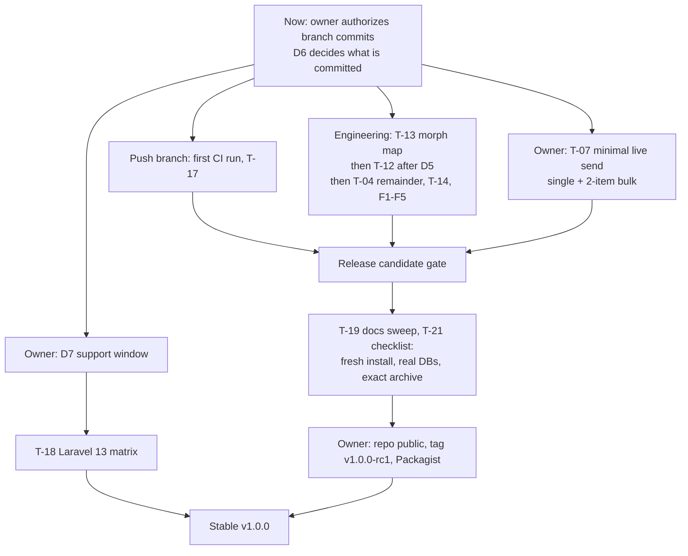

# Pre-commit and pre-publication readiness review

**Date:** 2026-11-10 (Africa/Nairobi)
**Reviewer:** Claude (read-only review; no source, test, or config file changed)
**Checkout:** `main` @ `f6b7627` plus all uncommitted work (38 modified tracked
files, 13 new test files, 20+ new `.docs` records). Nothing is committed or
tagged.
**Audience:** the project owner, deciding when to commit and when to
publish, and the engineers who will close the remaining items.
**Companion record:** `.docs/dev/decisions/2026-11-10-reliability-policy-decisions.md`
(D2/D3/D4 context, and the open D5/D6/D7/Q8).

---

## 1. Verdict

| Question | Answer |
|---|---|
| **Ready to commit?** | **Yes**, on a branch, under three conditions (§4). Committing soon is advisable: about 3,000 lines of reviewed work exist only in this working tree. |
| **Ready to publish (tag, Packagist)?** | **No.** Five blockers stand before a release candidate and four more before a stable `v1.0.0` (§5). |

The code that exists is in good shape: the full gate passes, the Composer
package contains only runtime files, no credentials are present, and the
three approved policies (D2, D3, D4) are implemented as decided. Every
remaining blocker is either missing evidence (live provider, CI, real
database) or work not started (schema, morph map, Laravel 13, test
doubles).

---

## 2. Evidence gathered today

| Check | Command / method | Result |
|---|---|---|
| Test suite | `php vendor/bin/pest --no-coverage` | **281 passed, 2,117 assertions**, seed 1794286324, 22.3 s (07:52 EAT) |
| Static analysis | `php vendor/bin/phpstan analyse --no-progress` | Level 8, no errors |
| Style | `php vendor/bin/pint --test` | Passed |
| Manifest | `composer validate --strict` | Valid |
| Whitespace | `git diff --check` | Clean |
| **Composer package contents** | Temporary index outside the repository (`GIT_INDEX_FILE` in the session scratch directory), `git add -A`, `git write-tree`, then `git archive --worktree-attributes` | **28 files:** `LICENSE`, `README.md`, `composer.json`, `config/textsms.php`, the migration stub, `routes/webhooks.php`, and 22 `src/` files. Tests, `docs/`, `examples/`, `.docs/`, `.agents/`, `.claude/`, `pint.json` excluded. The repository's real index was verified unchanged (0 staged files). |
| Credentials | Pattern scan of all non-vendor files | No credential-shaped values; no `.env` files |
| Personal data | Search for the test-recipient number | Tracked `docs/package-development-plan.md` (2); untracked `.docs` reviews (1 + 3); present in history (`e1db5df`) |
| D2 / D3 / D4 source | Read `TextSmsGateway::http()`, `recordDeliveryReport()`, the service provider's limiter and priority registration, the route, and the config | Match the approved decisions (see the decision record) |
| D2 / D3 / D4 tests | Test names in `SendRetryPolicyTest` (6), `PassiveDeliveryReportTest` (5), `WebhookRateLimitTest` (3, including 600 callbacks under the shipped default) | Present and passing |
| Framework support window | Laravel release notes, fetched 2026-11-10 | Laravel 12: bug fixes ended 2026-08-13, security fixes to **2027-02-24**. Laravel 13: released 2026-03-17, PHP 8.3+ |

**Not verified by this review:** any live TextSMS call, the CI workflows
on GitHub, a lowest-dependency install, a MySQL or PostgreSQL run, a Redis
limiter, Laravel 13, or a fresh-application install. No independent probes
were added beyond the existing suite.

Side effect to note: building the temporary tree wrote unreferenced
(dangling) objects into `.git/objects`. They are harmless and are removed
by the next `git gc`.

---

## 3. What is complete

| Work | State | Evidence |
|---|---|---|
| T-01 Lifecycle-event isolation (D1) | Accepted | Independent reviews 2026-11-02; lifecycle regressions |
| T-02 Atomic bulk preparation and response correlation | Accepted, plus cross-validation correction | `BulkPreparationAndCorrelationTest` |
| D3 Passive delivery reports (replaces T-03) | Accepted | `PassiveDeliveryReportTest` |
| D2 Bounded send retry (T-04 retry part) | Accepted | `SendRetryPolicyTest` |
| T-05 Webhook input and secret hygiene | Accepted | `WebhookTest` |
| D4 Authenticated callback limiter (T-06) | Accepted | `WebhookRateLimitTest` |
| T-08A Package archive exclusions | Accepted; confirmed again today on the real working tree (§2) | archive listing |
| T-09 Event serialization and listener contract | Accepted, plus documentation correction | `EventSerializationTest` |
| T-15 Lazy channel registration | Accepted | `ChannelRegistrationTest` |
| T-16A Stable-surface coverage | Accepted (full T-16 open) | `ArtisanStableSurfaceTest`, `ServiceProviderContractsTest`, others |
| T-20 Code hygiene | Accepted | `TestSendCommandTest` |
| T-11 Delivery-report support docs | Provisional; final wording needs T-07 | `docs/webhooks.md` |
| T-17 CI hardening | Prepared, never executed | workflow diffs |

---

## 4. Commit readiness — conditions

1. **Decide what enters the repository (D6, part b).** Do not commit
   `.claude/settings.json`; it holds local tool permissions. Decide whether
   `.docs/` and `.agents/` belong in a repository that will become public.
   The archive rules already keep them out of the Composer package either
   way.
2. **Commit on a branch, not `main`.** The publication checklist asks for
   pull requests and required checks on `main`. A branch also lets CI (T-17)
   run for the first time before anything merges.
3. **Follow `.agents/commit_directives.md`.** Stage explicit paths;
   Conventional Commit subjects; bodies ending with `Files modified:`; no AI
   attribution or co-author trailers; owner authorization before each
   commit and push.

Suggested slicing. Per-packet commits are not practical after the fact,
because several packets changed the same files (the gateway was changed by
T-01, T-02, D2 and D3), and interactive partial staging is not available
here.

| # | Commit | Paths |
|---|---|---|
| 1 | `fix(gateway): isolate lifecycle outcomes, bound send retries, record passive delivery reports` | `src/**`, `config/textsms.php`, `routes/webhooks.php`, `tests/**`, `phpstan.neon.dist` |
| 2 | `ci: validate, audit and widen the PHP and dependency matrix` | `.github/workflows/*`, `composer.json` (description only) |
| 3 | `chore(dist): exclude internal material from the package archive` | `.gitattributes` |
| 4 | `docs: align public documentation with the approved behaviour` | `README.md`, `docs/**`, `CHANGELOG.md`, `examples/**` (after F1 below) |
| 5 | Optional, only if D6 allows | `.docs/**`, `.agents/**` |

The commit-1 body should list the behaviours per packet (T-01, T-02, T-05,
T-09, T-15, T-20, D2, D3, D4) and the gate result. The CHANGELOG already
holds most of that text.

---

## 5. Publication blockers

### 5.1 Before a release candidate (`v1.0.0-rc1`)

| # | Blocker | Why it blocks | Closes with | Owner |
|---|---|---|---|---|
| B1 | **No live send has ever run through this code.** | The package generates a 26-character ULID for `clientsmsid`; the provider's documents only show integers. If TextSMS rejects or rewrites that value, sends fail or bulk correlation breaks. Response shapes, balance output, and the push contract are also unverified. | T-07 minimum: one single send and one 2-item bulk send to a consenting recipient; capture sanitized responses as fixtures. | Owner |
| B2 | **Personal data in a repository that must become public** (Packagist requires a public repository). | The test-recipient number is in tracked docs and history. | D6 → T-08B | Owner, then engineer |
| B3 | **Schema not settled** (D5). | After the first public install, changing the creation migration does not upgrade databases. `status` is an enum with an unused `rejected`; `attempt_count` default disagrees with the code. | D5 → T-12 | Owner, then engineer |
| B4 | **Morph map ignored** (T-13, finding R23, probe P12). | Rows store the class name, not the app's morph alias, so `whereMorphedTo()` cannot find them in apps that use a morph map. Changing stored values after release needs a data migration. | T-13 | Engineer |
| B5 | **CI has never run.** | The checklist requires green checks on the exact tagged commit. The new matrix (PHP 8.4, lowest dependencies) and `composer audit` are unproven. | Push the branch; T-17 green | Owner (push), engineer |

### 5.2 Before stable `v1.0.0`

| # | Item | Why | Closes with |
|---|---|---|---|
| B6 | **Laravel 13 support** (D7). | Laravel 12 receives security fixes only until 2027-02-24. A Laravel 12-only package published now is near its framework's end of life, and no Laravel 13 application can install it. | D7 → T-18 (needs a re-resolved test toolchain) |
| B7 | `balance()` reports provider error payloads as a balance; no credential pre-check (T-04 remainder). | `textsms:balance` prints an error as a balance and exits successfully. | T-04 remainder |
| B8 | Test doubles do not match the real gateway (T-14). | `FakeSmsGateway` accepts invalid input, and its failure mode writes no failed row and fires no failed event. Consumers' tests can pass against behaviour the real gateway does not have. | T-14 |
| B9 | Release mechanics (T-21). | Not yet done: local Composer is 2.7.6 (outdated); fresh Laravel 12 (and 13) application install; MySQL and PostgreSQL run for column limits, JSON and morph columns; the exact release archive; the full checklist. | T-21 |

### 5.3 Smaller findings from this review

| # | Finding | Severity | Fix |
|---|---|---|---|
| F1 | `examples/ReceiptNotification.php:23-25` tells readers to reconcile receipts from `SmsDeliveryReported`, which is no longer emitted (D3). | Medium (visible on GitHub, not in the package) | Rewrite the bullet; T-19 |
| F2 | `docs/upgrade-guide.md:33-35` says anyone tracking `dev-main` needs no migration. Behaviour changed substantially since `f6b7627` (no delivery events, new limiter config, retry policy). | Medium | Rewrite before the RC; T-19 |
| F3 | QPIMS migration plan (`docs/package-development-plan.md` steps 8–9) relies on an `SmsDeliveryReported` listener that will never run. | Medium (consumer impact) | Decide Q8; update the plan |
| F4 | `TextSmsNotificationServiceProvider::registerCallbackLimiter()` type-hints the concrete `Illuminate\Foundation\Http\Kernel` in a `callAfterResolving` callback. An application whose HTTP kernel is not a subclass of it would get a `TypeError` when the kernel resolves. Standard Laravel 11+ apps and Testbench are unaffected. | Low | Accept the contract and check `instanceof` |
| F5 | `CHANGELOG.md` still says the suite was "ported verbatim from QPIMS"; the release needs a dated version section and compare links. | Low | T-21 |
| F6 | Projects that already published the old config keep `throttle:60,1` as an extra limit. Documented in the CHANGELOG and webhook docs. No external installs exist yet. | Info | — |

---

## 6. Recommended path to publication

**Release-candidate exit criteria:** B1–B5 closed; F1–F3 fixed; full gate
and CI green on the exact commit; archive inspected; fresh Laravel 12
install works.

**Stable exit criteria:** B6–B9 closed; RC installed from Packagist into a
clean application; live send repeated on the tagged artifact.

---

## 7. Owner actions in one list

1. Authorize the branch and the commits in §4, and decide D6 part (b) on
   what enters the repository.
2. Decide D5 (schema), D6 (personal data, history), D7 (Laravel window),
   and Q8 (QPIMS delivery status). Context: the decision record.
3. Run the T-07 minimal live send.
4. Rotate `TEXTSMS_DLR_SECRET` wherever callbacks were received before the
   T-05 fix, and decide on old rows and logs.
5. Update local Composer before tagging.
