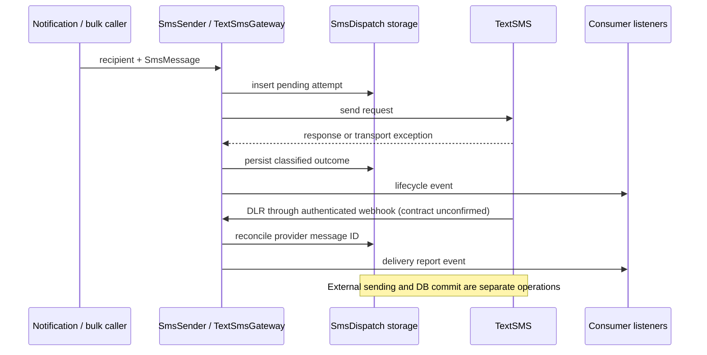

# Repository Context and Adversarial Implementation Plan Review

**Review date:** 2026-11-01, Africa/Nairobi\
**Reviewer:** Codex, with three independent analysis agents\
**Checkout:** `main` at `f6b76272d2d48e34b6e64956dfadcf7034d1f5ca`\
**Scope:** analysis and planning. No production code, tests, configuration, dependency constraints, or existing review documents changed. No commits, provider calls, credential use, or remote publication.

**Subsequent decision:** after this review, the owner selected D1-A on 2026-11-01. It is recorded in the November decision log and the [first-wave directive](../../directives/2026-11-01-first-wave-execution-directive.md). Statements below about the empty decision log describe the earlier review snapshot; D2-D7 remain open.

## 1. Assessment and execution authority

The package has appropriate boundaries for a small Laravel SDK, but the current checkout is not ready for a release candidate. Passing checks do not cover the known listener, bulk-preparation, retry, callback-secret, and reconciliation defects.

Use the [November consolidation](../claude/2026-11-01-consolidated-analysis-and-implementation-priorities.md) as the task index: T-01 through T-21. Retain the June review, June remediation plan, July review, and publication checklist as historical evidence. Their conflicting retry, event, migration-publishing, and DLR proposals must not become competing implementation specifications.

This document adds independently checked implementation constraints. It does not select the owner's D1-D7 choices or silently rewrite the consolidation. Its decision log remains empty. Proposed behavior must be distinguished from approved behavior in every implementation brief.

The governing repository directives were read in full:

- [absolute_task_mode.md](../../../../.agents/absolute_task_mode.md): correct behavior at the boundary that owns it; use existing framework capabilities; document planned and final changes under `.docs`; verify implementations.
- [commit_directives.md](../../../../.agents/commit_directives.md): commits and pushes require owner authorization; explicit staging; Conventional Commits; no AI attribution or co-author trailers.
- [doumentation_standards.md](../../../../.agents/doumentation_standards.md): explain state, failure, recovery, and evidence proportionally; separate observed behavior from inference.

The review covered the public Markdown documentation, extraction plan, examples, all five existing `.docs` review documents, package source, contracts, configuration, routes, migration, tests, Composer metadata, CI, and relevant installed Laravel internals. The bundled four-page provider PDF and Postman request inventory were also inspected. Three agents independently examined gateway integrity, webhook/runtime mechanics, and documentation/release readiness. Their findings were reconciled here against source and focused probes.

## 2. System model to preserve

| Boundary | Current responsibility | Consequence for changes |
|---|---|---|
| `SmsMessage` | Immutable content, sender override, client reference, metadata | Recipient routing stays outside the DTO. |
| `SmsChannel` | Notification adaptation; catches the two package exceptions | Raw listener exceptions can escape its current protection. SMS failure is normally logged and returned as null. |
| `SmsSender` | Single send, bounded bulk send, balance | Invalid input and provider failures have separate exception contracts. Mixed per-item bulk outcomes return rows; whole-batch failure throws. |
| `TextSmsGateway` | Provider wire format, persistence, response classification, DLR processing | Main implementation hotspot; one writer at a time. |
| `SmsDispatch` | One dispatch attempt, configurable table/connection, polymorphic owner | Acceptance is distinct from delivery. Client references do not establish provider idempotency. |
| `SmsDeliveryReportProcessor` | Inbound reconciliation | Same default instance serves outbound and inbound; outbound credential validation must not disable inbound processing. |
| Webhook middleware/controller | Authenticate and validate ingress, invoke processor | Authentication metadata must be removed before persistence, events, or logs. |
| Three lifecycle events | Consumer extension points | Domain state remains in consumer listeners. Current dispatching is synchronous unless listeners queue themselves. |
| Fake and LogOnly gateways | Consumer tests and local operation | They need contract parity for validation and lifecycle behavior. |
| Service provider | Bindings, channel/middleware registration, routes, commands, publication | Shared integration file; several task packets modify it. |



The diagram shows the intended ordering, not a guarantee that listener failures, storage failure, process termination, or outer transactions are safe today. The package has no shipped poller, durable event outbox, automatic retry command, failover sender, sender pool, or queued-sender decorator. Documentation recipes do not make those features implemented or verified.

## 3. Fresh verification and its limits

All results below were obtained during this review on 2026-11-01 with local PHP 8.2.12 and the existing installed dependencies. Dependencies were not updated.

| Check | Actual result |
|---|---|
| `php vendor/bin/pest --no-coverage` | 52 passed, 131 assertions; reported duration 8.85 s; random seed 1793563475 |
| `php vendor/bin/phpstan analyse --no-progress` | No errors, configured level 8 |
| `php vendor/bin/pint --test` | Passed |
| `composer validate --strict` | Valid |
| `git diff --check` | Passed |
| Git state | Two local commits, no local tags; `.agents/`, `.claude/`, `.docs/` already untracked |
| Attribute semantics | `docs` and `.github` report `export-ignore: set`; their tested child files report `unspecified` |

PHP prints an Imagick/ImageMagick version mismatch warning at startup. The checks still completed successfully; this review did not investigate that unrelated installation warning.

Four additional in-memory PHP probes ran through standard input with autoloaded package/framework classes. Provider requests were faked and stray requests prohibited. No probe file or application database was created.

| Probe | Observed result | Evidence meaning |
|---|---|---|
| Distinct request IDs `review-a`, `review-b`; provider returns two responses for `review-a` with IDs `review-111`, `review-222` | A stores `review-222`; B becomes failed | Current response parser silently overwrites duplicate correlation keys. |
| Provider returns `responses: [{respose-code: 200}]` without `messageid` | Returned row is sent with null provider ID | Current acceptance permits a row that cannot receive matched DLRs. |
| A local event using the proposed `SerializesModels` trait is serialized with failed status, then its row becomes delivered before restoration | Event scalar remains failed; restored model is delivered | Demonstrates the proposed serialization semantics; the trait is not yet installed on the package events. |
| Two ordered Laravel listeners; first throws | Second listener never runs | Rescuing the overall dispatch protects the caller, but cannot guarantee all listeners execute. |

The corrected four-probe run exited 0. An initial inline harness invocation produced the first three observations but failed in Testbench teardown because PHPUnit's configuration registry was not initialized. The harness was corrected to initialize that registry and rerun; that initial infrastructure failure is not a package regression.

The consolidation's 21 historical probes were not rerun as a suite. Their source mechanisms were cross-checked, and the existing suite was rerun. No current dependency audit, lowest/stable dependency installation, Laravel 13 execution, MySQL/PostgreSQL smoke test, archive build, live provider call, remote tag check, or repository-visibility check was performed. Historical results must retain their original dates.

## 4. Corrections to attach to the existing task packets

### AR-01: Make T-01's persistence boundary explicit

**Source:** `src/Gateways/TextSmsGateway.php:125`, `:164`, `:445`, `:471`.

The consolidation correctly isolates consumer listeners, but still includes persistence in the proposed provider-classification try/catch. A failed DB write or model observer after provider acceptance is not proof of provider rejection. Do not fix listener corruption while retaining a catch-all that relabels an accepted send after a storage exception.

Add an acceptance case that fails persistence after a faked accepted provider response. Preserve the distinction between accepted externally and failed to record locally; define the surfaced error and recovery evidence. Do not introduce a new exception hierarchy or outbox without a demonstrated need.

Move the small R37 length correction forward from general T-20 hygiene into this reliability work. Both `markSent()` at line 453 and `markFailed()` at line 483 write unrestricted descriptions into the migration's 255-character column. Cover both paths and multibyte boundaries. SQLite does not prove real database length enforcement; retain MySQL strict-mode verification before release.

**Evidence:** storage-failure consequences are source-derived, not newly injected in this review.

### AR-02: Extend T-02 to validate response correlation

**Source:** `TextSmsGateway.php:194`, `:259`, `:450`, `:545`, `:610`.

Prevalidating caller references does not protect against duplicate, missing, unexpected, or malformed provider response references. The duplicate-response probe confirms `keyBy()` discards an earlier response. Add fixture cases for those shapes and reordered responses; preserve input-order results and record correlation anomalies without guessing safe rejection.

The missing-message-ID probe also confirms that provider code 200 alone can create an unreconcilable sent row. Define the outcome of code 200 without a usable provider ID, and of a success-shaped body on an HTTP error response. An apparently accepted message with incomplete correlation must not be presented as safe to resend.

The provider-ID column is indexed, not unique, and DLR lookup selects the first match. Do not claim globally enforced one-to-one mapping. T-07 must establish ID scope before any broader database uniqueness constraint is proposed.

### AR-03: Specify T-03's concurrency algorithm before coding

**Source:** consolidation section 6.2; current `TextSmsGateway.php:320`.

The delivered-final recommendation is reasonable, pending D3. Its conditional-update sketch needs exact predicates. If both concurrent first-delivery writers read sent, then both updates permit sent or delivered while assigning a new timestamp, the second can replace the first timestamp. Use the exact observed state or distinguish first transitions from repeats atomically. Define behavior when a repeated compare-and-update loses again or the row is deleted.

Required deterministic interleavings: delivered versus failed; two first delivered reports; two first failed reports; unknown versus terminal. Preserve the first terminal timestamp and keep the opposite timestamp clear. Repeated events and duplicate durable effects are separate concerns.

Query-builder updates bypass normal model assignment casts. Installed SQLite/MySQL/PostgreSQL grammars encode array update values; therefore an array-to-string defect on those engines was not established. SQL Server handles bindings differently. Verify JSON payload round trips on supported drivers and preserve the existing model encoding boundary where needed.

### AR-04: T-01/T-09 need listener-delivery and event-order contracts

**Source:** `vendor/laravel/framework/src/Illuminate/Events/Dispatcher.php:318`; `vendor/laravel/framework/src/Illuminate/Queue/SerializesAndRestoresModelIdentifiers.php:106`; `docs/events.md:144`.

The probes confirm two different limits:

1. `rescue(event(...))` protects the send result, but the first throwing synchronous listener prevents later listeners, including later queue submissions, from running. Describe dispatch as best effort. A queued listener is not itself a durable publication guarantee.
2. After T-09, historical event scalars can disagree with the restored current model. An old failed report must not make a domain object failed after a later delivered report. Update the consumer examples to reconcile authoritative current dispatch state and the current attempt. Idempotency alone does not solve ordering across reports or attempts.

Add the serialization scenario and an ordered two-listener case to acceptance. Durable publication infrastructure remains separate future work unless explicitly required.

### AR-05: Tighten T-04's outbound boundary

**Source:** `TextSmsNotificationServiceProvider.php:64`; `TextSmsGateway.php:180`, `:345`, `:366`.

Place credential validation at outbound operation boundaries before rows or HTTP calls. A constructor guard could disable inbound DLR reconciliation because the service provider resolves the same gateway for both contracts. Verify inbound processing without outbound credentials; retain or explicitly redefine empty-bulk behavior.

Test errno 6/7 separately from 28/52 and from missing handler context, for both single and bulk sends. The absence of an HTTP response does not establish that sending never occurred. T-07's idempotency answer may justify later policy changes; it is not known today.

### AR-06: Broaden T-05's input and secret acceptance

**Source:** `src/Http/Middleware/VerifyTextSmsCallback.php:52`, `:87`; `src/Http/Controllers/TextSmsCallbackController.php:47`, `:56`; `TextSmsGateway.php:297`, `:300`, `:315`; `LogOnlySmsGateway.php:113`.

Removing the top-level token at HTTP ingress fixes the demonstrated callback path. It does not establish an absolute guarantee for public processor calls, whose missing-ID branch or LogOnly implementation can log the full supplied payload. Define either sanitized-input preconditions or consistent sanitization at those public boundaries. Include LogOnly in the secret regression checks.

Malformed array tokens, IDs, and statuses currently reach string casts or an insufficient `empty()` check. Add deterministic 401 for invalid token shapes and 422 for malformed authenticated payload fields, with zero mutations/events and keys-only diagnostics. Preserve legitimate integer/string provider IDs and alternate field names. These type-error paths were identified statically, not newly probed.

Retain the original T-05 owner follow-up: rotate callback secrets in affected deployments after the fix and assess retained rows/logs containing the old value. Correcting future ingress does not remove historical exposure. No deployment state was inspected or changed here.

### AR-07: Qualify durability and plan early-DLR recovery

**Source:** `TextSmsGateway.php:101`, `:111`, `:305`, `:437`, `:450`; `TextSmsCallbackController.php:56`; `docs/queueing.md`.

An external send cannot roll back with a business transaction. A caller's outer rollback can erase the inserted dispatch after a billed send. T-02's nested insertion transaction does not independently commit that outer transaction. Document notification dispatch after the business commit. Listener `afterCommit` advice addresses another boundary and does not solve outbound I/O rollback.

A callback can also arrive before the response's provider ID is saved. It then cannot match and is acknowledged without reconciliation. This timing scenario is source-derived, not reproduced here. A poller can repair ordinary sent rows once their ID is stored. Consider that recovery benefit even if T-07 confirms push; do not claim push confirmation alone removes the timing window.

Qualify invariant I2: the normal completed path should resolve pending rows, but process interruption, unavailable storage, or outer rollback can leave unknown or incomplete outcomes. Exactly-once sending is not established.

### AR-08: Correct T-08's attribute test and split its decisions

**Source:** `.gitattributes:8`; consolidation T-08 acceptance.

A directory `export-ignore` attribute excludes that directory from a Git archive, but does not make `git check-attr` on each child report set. This was directly checked against existing docs and GitHub rules. Test the directory attributes and inspect an archive containing the intended tracked files. Add recursive patterns only if recursive attribute reporting is itself desired.

Current internal reviews are untracked, so an archive of current HEAD cannot prove those reviews will be excluded once committed. Verify the intended release tree when that operation is authorized. Export exclusions govern distribution; they do not hide tracked files or their history in a public repository.

Separate harmless archive-rule work from D6's decisions about recipient consent, public disclosure, and any history rewrite. The latter decisions are still open. Do not reproduce the actual recipient value in new artifacts.

### AR-09: Refine T-09/T-12/T-13/T-14 integration acceptance

- T-12 must cover an existing installation: editing a creation migration does not upgrade a database where it already ran. Do not infer absence of dev-main users from absence of local tags. Retain publish-once semantics and account for the application's migration-date setting.
- T-13 must restore both the prior morph map and `requireMorphMap` in tests; `enforceMorphMap()` changes both. Associate through the existing relation in all three senders.
- T-14 must apply complete bulk preflight and listener-isolation behavior to both doubles, including empty/20/21-item boundaries. Invalid input should fail before a configured simulated provider rejection. Preserve the configured provider exception even if its failure listener throws.
- The fake's `shouldThrow()` documentation says next send, while its flag persists. Decide and test the desired scope.
- T-15/T-14 must exercise a channel resolved through the actual `ChannelManager`, then install the fake and verify interception. Constructing `SmsChannel` manually does not establish cache invalidation.

### AR-10: Make T-10's operating limits reviewable

Wait for exact sanitized T-07 response fixtures. Define whether the budget counts candidates or actual HTTP attempts, especially if lookups retry. Exclude null/empty provider IDs; `awaitingDlr()` currently does not. Specify age boundaries, override semantics for `--message-id`, continuation after individual errors, and exit status.

Oldest-first selection can repeatedly consume the budget on unresolved 1008 rows and delay newer rows. Specify bounded fairness or document the limitation. Unknown provider shapes must remain observable without inventing delivery state. These are specification gaps, not reasons to add an independent reconciliation framework.

### AR-11: T-17/T-18 need actual dependency graphs

**Source:** `composer.json`; `.github/workflows/tests.yml:41`; installed `vendor/pestphp/pest-plugin-laravel/composer.json:16`.

The installed Pest Laravel plugin requires framework `^11.39.1|^12.9.2` and Pest `^3.8.2`. Widening Illuminate and Testbench alone does not validate Laravel 13. Pin the intended Testbench/framework major per matrix row, resolve compatible testing packages, and run both lowest and stable graphs. The historical Laravel 12.0.1 result is not proof that today's development graph resolves to that lower bound.

Official [Laravel release notes](https://laravel.com/framework/docs/releases) confirm Laravel 13's March 17, 2026 release and PHP 8.3 minimum. [Testbench package metadata](https://packagist.org/packages/orchestra/testbench) confirms an 11.x line exists; the inspected v11.3.0 entry requires PHP `^8.3`, Laravel `^13.32.0`, and supports several PHPUnit majors. These facts establish availability, not package compatibility. The local PHP 8.2 run cannot validate Laravel 13.

The ignored lockfile does not inherently invalidate `composer audit --locked`: CI's `composer update` creates a local lock. Choose an installed-package or generated-lock audit deliberately and record what was audited. No fresh audit was performed here.

### AR-12: Expand T-19 beyond the recorded wording defects

Include these source-backed examples in the final truthfulness sweep:

| Document | Additional correction |
|---|---|
| `docs/events.md:144` | Reconcile current state and current attempt under reordered queued events. |
| `docs/extending-providers.md:173` | Failover on every provider exception can duplicate an ambiguously accepted SMS. The earlier sample DLR code also needs status/timestamp consistency. |
| `docs/queueing.md:101`, `:117`, `:121` | Job retries start new sends; placeholder deletion provides no idempotency; saved morph aliases cannot be resolved as class names; explain after-commit dispatch. |
| `docs/upgrade-guide.md:33` | No-migration/no-surface-change promise conflicts with planned schema and fake behavior changes. |
| `docs/operations.md:22`, `:59` | Fix the example namespace and unsafe transport retry guidance. A failed row is not necessarily a proved provider rejection. |
| `docs/bulk-batching.md` | Correct PostgreSQL JSON example; distinguish rejected batches from unknown sending outcomes. |
| `CONTRIBUTING.md:25` | CI disables coverage; do not claim enforced coverage measurement. |
| `docs/roadmap.md:6` | Shipped language conflicts with the local unreleased state. Remote publication status remains unverified. |

Draft safety-relevant retry, event, and DLR wording alongside its behavior change, then perform the final cross-document sweep. Do not wait until the end to explain behavior already changed.

## 5. Priority and dependency plan

Preserve the November task IDs and most of its ordering. Attach the acceptance corrections above before assigning implementation. Behavioral decisions can be answered as their tasks approach; they need not prevent independent analysis or archive-rule preparation.

| Stage | Work | Exit evidence |
|---|---|---|
| Preparation | Record applicable D1-D7 choices; prepare owner T-07 capture; split T-08 archive mechanics from D6 disclosure/history decisions | Concrete task briefs and sanitized fixture requirements; no assumed provider guarantees |
| First engineering work | T-08 archive rules; gateway T-01 then T-02; webhook T-05 independently | Real-listener regressions, zero-write invalid-bulk tests, correlation-anomaly cases, secret/type checks |
| Complete P0 reliability | Gateway T-03 then T-04; webhook T-06 after D4; include both description-length paths | Transition/interleaving tests, precise request counts, operation-specific retry tests, package-default middleware tests |
| RC integration | T-13 before T-14; T-09, T-12, T-15; T-11; T-10 after T-07 when required for the supported DLR path | Contract-faithful doubles, real manager-resolution test, migration/serialization checks, supported reconciliation fixtures |
| Stable readiness | T-16-T-20 completion, including T-17/T-18 compatibility work; final documentation sweep | Green declared dependency matrix; current audit; corrected checklist |
| Release execution | T-21 after all applicable gates | Exact-artifact fresh installs, real DB checks, owner-operated live smoke, authorized tag/publication |

T-07 is early owner work because its findings affect bulk identifiers, idempotency, response parsing, and DLR support. It is not an agent live-call assignment. No provider support message is sent without explicit authorization.

D1-D7 are not the entire specification. Before assigning the affected packet, make AR-01's post-acceptance storage-error and recovery behavior, AR-02's incomplete acceptance/correlation outcomes, and AR-10's polling budget, fairness, and exit rules explicit. Resolve routine implementation details at their existing boundaries; escalate product-contract tradeoffs with concrete alternatives and evidence.

Recommended choices remain D1-A (report listener failures), D2-A or the simpler D2-B after tradeoff review (only proven pre-send failures or no automatic send retries), D3-A (delivered final), D4-A (no default throttle), D5-A (framework publication/publish once), and D7-A (validate both framework majors). D6 requires the owner's separate privacy/disclosure choices. None was approved by this analysis request.

The previously deferred sender pools, failover, scheduled sending, HMAC middleware, queued decorator, and retry command stay deferred. T-01-T-04 and T-13 should settle before feature work changes the gateway.

## 6. Agent orchestration and adversarial handoff

Agents share this working tree. The original lanes overlap beyond `TextSmsGateway.php`: T-13 and T-14 both edit the doubles; T-04/T-10/T-12/T-15 touch the service provider; multiple tasks share config, README, CHANGELOG, and gateway/webhook tests.

Use these ownership rules:

1. One active writer owns `TextSmsGateway.php` and its shared regression file, in T-01 -> T-02 -> T-03 -> T-04 -> T-13 -> T-10 order.
2. A webhook writer owns controller/middleware changes and `WebhookTest.php`; coordinate the config handoff before T-06. The gateway owner must not edit that same test file concurrently for T-01.
3. Finish T-13 association changes in the doubles before T-14, or hand those exact changes to the doubles owner explicitly.
4. Reserve service-provider, config, Composer, README, and CHANGELOG integration to one writer at a time. Different methods are still one shared file.
5. Avoid concurrent use of the consolidation's single temporary probe filename. Prefer focused regression files owned by the task when practical. Do not allow one agent's formatting or broad checks to modify another's unfinished work.
6. Run targeted checks during each task and the full integrated gate on a stable tree. An independent reviewer checks the resulting diff against invariants and failure scenarios before acceptance.

Every brief should include:

```text
Task: T-XX from the November consolidation + applicable AR-XX constraints here.
Baseline: exact commit and relevant working-tree state.
Decisions: explicit approved choices, plus unresolved choices that constrain scope.
Ownership: exact source, test, config, and documentation paths; shared-file handoffs.
Behavior: inputs, state transitions, exception/event contract, retries, unknown outcomes.
Acceptance: observable assertions and required failure/interleaving cases.
Evidence: tests actually run, dated outputs, static deductions, remaining limitations.
Deliver: implementation + meaningful regression tests + proportional .docs task record.
Restrictions: no commit/push/publication/history rewrite/live provider calls unless authorized.
Review: independent adversarial review, then integrated quality gate.
```

Reviewer focus: irreversible side effects must not be mistaken for reversible failures; provider outcomes must survive consumer failures; bulk outcomes must remain correlated; terminal state must survive stale and concurrent reports; secrets must stay out of package-controlled persistence and output; unknown sending outcomes must not imply safe retries.

## 7. Completion state

Contextualization and analysis are complete for this checkout. This review establishes a source-grounded execution map and identifies corrections to the proposed acceptance criteria. It does not establish live provider compatibility, release readiness, exactly-once sends, durable event publication, or approval of pending behavioral decisions.

The only authored repository artifact is this analysis document. Implementation remains a subsequent task. Recheck Git state and the applicable decisions before starting that work, because a new user change or implementation can invalidate this baseline.
